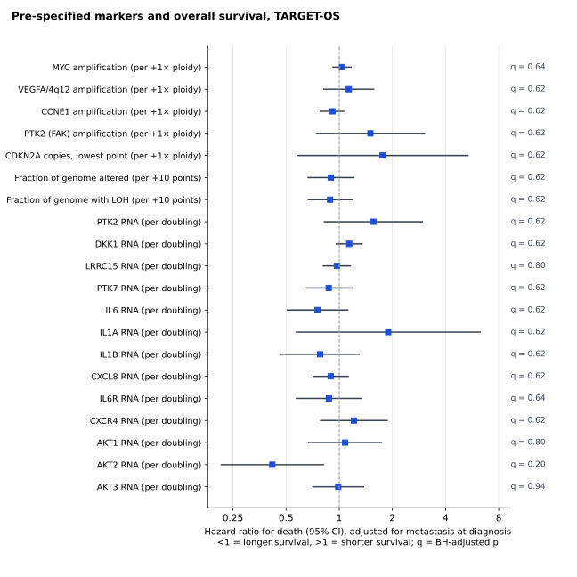

# Do the leads predict survival? A test in open patient data

*Built November 22, 2026 from open NCI Genomic Data Commons (GDC) data for the TARGET osteosarcoma project: clinical records, tumour RNA and tumour copy number for up to 89 children and young adults. Script: `tools/survival_analysis.py`. Results table: `data/osteosarcoma_survival_results.csv` (one row per test). Figures: `docs/figures/survival_*.svg`. Working notes, including the analysis plan written before any marker was compared with outcome: `research_notes/Survival/notes.md`. This is new evidence produced by this project, not a literature summary.*

## Summary

We asked whether the tumour features behind this project's leads (gene amplifications, gene activity and genome damage) go with shorter survival in 89 young patients from the US TARGET osteosarcoma study. The method works: metastasis at diagnosis, the best-known risk factor, came out exactly as expected, with about five times the risk of death. None of the 20 lead-related markers we chose in advance showed a convincing link with survival or with metastasis at diagnosis once we allowed for the number of tests. Most notably, MYC amplification, reported in 2025 to triple the risk of death, made no visible difference here, and even the upper end of our confidence range falls below the reported effect. With only 30 deaths, the study could reliably detect only large effects (roughly a tripling of risk), so for most leads the honest answer is "no association detected, too small a study to rule out a moderate one", which neither strengthens nor weakens them much.

**How to read the labels.** After key numbers we say where they come from:

- **(our calculation)**: computed by this project from the open data files named above. Every number in the tables of this report is (our calculation) unless it carries another label.
- **(paper, full text)**: read in the full published paper.
- **(paper, abstract only)**: read only in the abstract.
- **(registry)**: an official database record, here the NCI GDC.

**Statistical terms, defined once.**

- **HR (hazard ratio):** how much higher the risk of death (or of relapse or death) is in one group than another at any moment. 1 means no difference; 2 means twice the risk; 0.5 means half.
- **95% CI (confidence interval):** the range of HRs compatible with the data. A CI that includes 1 means no clear difference.
- **p:** the raw p-value for one test. **q:** the p-value after the Benjamini–Hochberg correction for running many tests. We call a result convincing only if q < 0.10 for the main test.
- **OS (overall survival):** time to death from any cause. **EFS (event-free survival):** time to relapse, progression, a second cancer or death, whichever came first.

## What we did

**Patients.** TARGET-OS patients with tumour RNA (88) or copy-number data (81) from the diagnostic biopsy, before treatment: 89 in all, 52 male and 37 female, median age 14.5 years (range 3.6–32.4), diagnosed 2000–2012 and treated on US cooperative-group and other chemotherapy protocols (registry). 23 of 88 had metastases at diagnosis. 87 have survival data, with 30 deaths; patients still alive were followed for a median of 4.7 years. 85 have event-free survival data, with 42 events (our calculation).

**Clinical data.** The GDC case records hold vital status, days to death or last follow-up, first event (relapse, death, second cancer) with its timing, metastasis at diagnosis, age and sex for nearly every patient. Histologic response (tumour kill by pre-surgery chemotherapy) exists for only 35 of the 89, from the open clinical spreadsheet, so it was used only as an extra check. The two sources agree except for three patients' follow-up times, which we tested both ways (registry; our calculation). Field-by-field counts are in the notes, section 1.

**Plan fixed in advance.** Before comparing any marker with any outcome, we wrote down 20 markers, the tests and the correction for multiple testing (notes, section 2):

- **Copy number** (calls as in `reports/Copy-number changes and the kinase-pill biomarker.md`: amplified = at least twice the tumour's average copy number): MYC; any of VEGFA, KDR, PDGFRA or KIT; CCNE1; PTK2 (FAK); and deep deletion of CDKN2A.
- **Genome damage:** fraction of the genome with changed copy number, and fraction with loss of heterozygosity (LOH, one parental copy lost), the measure a 2025 *Cell* paper found prognostic (paper, abstract only; PMID 39814020). Ours comes from SNP arrays, not whole genomes.
- **RNA:** PTK2, DKK1, LRRC15, PTK7, IL6, IL1A, IL1B, CXCL8, IL6R, CXCR4, AKT1, AKT2 and AKT3.

For each marker: (A, the main test) a Cox model of OS with the marker as a continuous value, adjusted for metastasis at diagnosis; (B) Kaplan–Meier curves and a log-rank test for OS, splitting at amplified/not or at the median RNA level; (C, D) the same for EFS; (E) whether the marker differs between patients with and without metastasis at diagnosis. Each group of 20 tests was corrected separately; we also corrected across all 100. Sensitivity checks: adding age, using the alternative follow-up times, and a check that the HR is stable over time. The statistics were coded with numpy and scipy; for the six markers and the controls we cross-checked, they agree with the standard `lifelines` package to four decimal places (our calculation).

## First check: does the method find what it should?

Yes. Patients with metastasis at diagnosis had 4.8 times the risk of death (95% CI 2.3–10.0; p = 0.000003), with 25% alive at five years against 76% (our calculation; `docs/figures/survival_metastasis_os.svg`). This matches the long-known gap in osteosarcoma. Good histologic response also went with longer survival, in the expected direction (HR 0.25, 0.05–1.18, p = 0.059; 35 patients) (our calculation).

**How big an effect could we see?** With about 29 deaths and a median split, the study had 80% power to detect an HR of about 2.8 or more; for amplifications present in 11–33% of patients, about 3.1–5.3 (our calculation, Schoenfeld's formula). Smaller effects, such as an HR of 1.5, could easily be missed.

## Results: the 20 pre-specified markers

Overall survival. The main test (A) is the continuous marker, adjusted for metastasis at diagnosis. The split test (B) compares amplified with not amplified, or above with at-or-below the median RNA level, without adjustment. All values (our calculation).

| Marker | Lead | n (deaths) | A: HR (95% CI) | A: p | A: q | B: HR, split (95% CI) | B: p | 5-year OS, marker+ vs marker− |
|---|---|---|---|---|---|---|---|---|
| MYC amplification (per +1× ploidy) | 2 (MYC as a variable) | 79 (28) | 1.04 (0.92–1.17) | 0.55 | 0.64 | 1.18 (0.54–2.56) | 0.68 | 60% vs 61% |
| VEGFA or 4q12 (KDR/PDGFRA/KIT) amplification (per +1× ploidy) | 2 | 79 (28) | 1.13 (0.82–1.57) | 0.45 | 0.62 | 0.56 (0.20–1.63) | 0.28 | 70% vs 58% |
| CCNE1 amplification (per +1× ploidy) | dropped (CDK2) | 79 (28) | 0.92 (0.78–1.07) | 0.28 | 0.62 | 0.65 (0.22–1.86) | 0.42 | 68% vs 59% |
| PTK2 (FAK) amplification (per +1× ploidy) | 4 (FAK) | 79 (28) | 1.50 (0.74–3.04) | 0.26 | 0.62 | 1.13 (0.39–3.30) | 0.82 | 62% vs 61% |
| CDKN2A deep deletion (A: lowest copy number) (per +1× ploidy) | — | 79 (28) | 1.76 (0.58–5.36) | 0.32 | 0.62 | 1.02 (0.35–2.96) | 0.97 | 55% vs 62% |
| Fraction of genome altered (per +10 points) | 12 (genome damage) | 79 (28) | 0.90 (0.67–1.20) | 0.46 | 0.62 | 0.75 (0.36–1.59) | 0.46 | 66% vs 55% |
| Fraction of genome with LOH (per +10 points) | 12 (genome damage) | 79 (28) | 0.89 (0.67–1.18) | 0.41 | 0.62 | 0.81 (0.38–1.70) | 0.57 | 65% vs 57% |
| PTK2 RNA (per doubling) | 4 (FAK) | 85 (29) | 1.56 (0.82–2.95) | 0.17 | 0.62 | 1.23 (0.59–2.56) | 0.58 | 61% vs 68% |
| DKK1 RNA (per doubling) | 4 (DKK1) | 85 (29) | 1.14 (0.96–1.35) | 0.13 | 0.62 | 1.72 (0.82–3.61) | 0.15 | 55% vs 73% |
| LRRC15 RNA (per doubling) | 5 | 85 (29) | 0.97 (0.81–1.16) | 0.73 | 0.80 | 1.14 (0.55–2.37) | 0.73 | 62% vs 66% |
| PTK7 RNA (per doubling) | 6 | 85 (29) | 0.87 (0.64–1.18) | 0.37 | 0.62 | 0.88 (0.42–1.84) | 0.73 | 63% vs 65% |
| IL6 RNA (per doubling) | 1 | 85 (29) | 0.75 (0.51–1.12) | 0.16 | 0.62 | 0.92 (0.44–1.95) | 0.83 | 65% vs 62% |
| IL1A RNA (per doubling) | 1 | 85 (29) | 1.89 (0.57–6.29) | 0.30 | 0.62 | 1.05 (0.50–2.19) | 0.90 | 64% vs 65% |
| IL1B RNA (per doubling) | 1 | 85 (29) | 0.78 (0.47–1.30) | 0.34 | 0.62 | 0.83 (0.40–1.74) | 0.63 | 66% vs 63% |
| CXCL8 RNA (per doubling) | 1, 9 | 85 (29) | 0.89 (0.71–1.12) | 0.34 | 0.62 | 0.79 (0.37–1.67) | 0.53 | 70% vs 58% |
| IL6R RNA (per doubling) | 1 | 85 (29) | 0.87 (0.57–1.33) | 0.53 | 0.64 | 0.93 (0.44–1.96) | 0.85 | 67% vs 61% |
| CXCR4 RNA (per doubling) | 14 | 85 (29) | 1.21 (0.79–1.87) | 0.38 | 0.62 | 1.48 (0.70–3.14) | 0.30 | 59% vs 69% |
| AKT1 RNA (per doubling) | 13 | 85 (29) | 1.08 (0.67–1.73) | 0.76 | 0.80 | 1.05 (0.51–2.20) | 0.89 | 64% vs 65% |
| AKT2 RNA (per doubling) | 13 | 85 (29) | 0.42 (0.21–0.81) | 0.01 | 0.20 | 0.85 (0.40–1.78) | 0.66 | 65% vs 63% |
| AKT3 RNA (per doubling) | 13 | 85 (29) | 0.99 (0.71–1.37) | 0.94 | 0.94 | 0.64 (0.31–1.35) | 0.24 | 67% vs 61% |

"Per +1× ploidy" means per extra copy-number unit equal to the tumour's average copy number; "per doubling" means per twofold rise in RNA. For copy-number markers the split is amplified (or deep-deleted) against not; for the others it is the median. The B-test q-values were all 0.95 or higher.

**Event-free survival and metastasis at diagnosis** (tests C, D and E; all values our calculation). No marker passed. The strongest raw results:

| Marker | Test | Result | p | q |
|---|---|---|---|---|
| AKT2 RNA | C: EFS, continuous, adjusted | HR 0.44 (0.23–0.84) | 0.01 | 0.26 |
| IL6 RNA | C: EFS, continuous, adjusted | HR 0.68 (0.46–1.00) | 0.05 | 0.48 |
| DKK1 RNA | C: EFS, continuous, adjusted | HR 1.14 (0.99–1.31) | 0.07 | 0.48 |
| Fraction of genome with LOH | D: EFS, above vs at-or-below median | HR 0.55 (0.28–1.05) | 0.06 | 0.83 |
| DKK1 RNA | D: EFS, above vs at-or-below median | HR 1.72 (0.92–3.21) | 0.09 | 0.83 |
| Fraction of genome altered | E: metastatic vs not | lower in metastatic tumours (median 56% vs 69%; rank-biserial r = -0.38) | 0.008 | 0.16 |
| VEGFA or 4q12 amplification | E: metastatic vs not | 2 of 19 amplified vs 21 of 62 not amplified were metastatic; odds ratio 0.23 (0.023–1.14) | 0.08 | 0.70 |

Across all 100 pre-specified tests together, the smallest corrected q was 0.44 (our calculation). Adding age to the main model, or using the alternative follow-up times, changed no conclusion (notes, section 4.4).

## The MYC result, in more detail

A 2025 study of 105 children and young adults reported 3-year survival of 27% with MYC amplification against 74% without, an adjusted HR of 3.4 (paper, abstract only; *Cancer* 2025, PMID 41199591). The leads report cites it to argue that MYC status should be recorded in any kinase-pill biomarker study. Here:

- By our pre-specified call (at least twice the tumour average), 26 of 79 patients were MYC-amplified; 5-year OS was 60% against 61%, HR 1.18 (0.54–2.56) (our calculation; `docs/figures/survival_myc_amp_os.svg`).
- That study counted "more than 7 copies" as amplified, so after seeing the result we also tried 8 or more copies. This was **not pre-specified** and is labelled post hoc in the results table. 23 of 79 were positive; HR adjusted for metastasis 1.45 (0.65–3.23), log-rank p = 0.63, 5-year OS 60% against 61% (our calculation).
- Both upper confidence limits (2.56 and 3.23) fall below the published 3.4. Our data therefore argue against an effect that large in TARGET-OS, though a moderate effect remains possible. The two cohorts may differ in how copies were counted (29% positive here against 16% there), and we could not tell from the abstract whether the published cohort includes TARGET patients.

## What this means for each lead

Lead numbers follow `reports/Ranked leads and research partners.md`. **Strengthen**, **weaken** or **no information** is our judgement of what these data add, not a re-scoring of the lead.

| Lead | Markers tested | What we found | Verdict |
|---|---|---|---|
| 1. Block IL-1 or IL-6 after surgery | IL6, IL1A, IL1B, CXCL8, IL6R tumour RNA | No link with survival. IL6 RNA leaned towards *longer* event-free survival (HR 0.68, 0.46–1.00, p = 0.05, q = 0.48). | **No information.** The lead is about inflammation from the lung and host after surgery, not tumour RNA at diagnosis, so these data cannot test it. |
| 2. Gene amplifications and VEGFR2-blocking pills | VEGFA or 4q12 amplification; MYC amplification | Amplification did not mark worse survival under standard chemotherapy (HR 0.56, 0.20–1.63). MYC showed no effect, and the published HR of 3.4 lies outside our range. | **No information** on the real question (who benefits from the pill), which needs pill-treated patients. **Weakens** the claim that MYC amplification is a strong poor-outlook marker; keep MYC as a variable anyway. A modest plus: amplification is not itself a strong outlook marker, so it is less likely to confound a pill-benefit study. |
| 4. FAK or DKK1 blockade in dogs | PTK2 amplification and RNA; DKK1 RNA | All point towards worse survival with more PTK2 or DKK1 (DKK1 above median: 5-year OS 55% against 73%, HR 1.72, 0.82–3.61), but none is statistically convincing (all q ≥ 0.48). | **No information**; a weak trend in the expected direction, not evidence. |
| 5. LRRC15 surface target | LRRC15 RNA | No link with survival (HR 0.97, 0.81–1.16). | **No information.** A surface target does not need to predict outcome; LRRC15 is made in nearly every tumour regardless of outlook. |
| 6. PTK7 surface target | PTK7 RNA | No link (HR 0.87, 0.64–1.18). | **No information**, for the same reason. |
| 12. Dog genome re-analysis (genome-wide LOH predicts outcome in people) | LOH fraction; fraction of genome altered | No link with survival. If anything, more LOH leaned towards *fewer* relapses (HR 0.55, 0.28–1.05, p = 0.06). Metastatic tumours had less of the genome altered (p = 0.008, q = 0.16). | **Weakens slightly.** The *Cell* 2025 finding did not replicate with our array-based measure, which is cruder than whole-genome LOH. |
| 13. AKT blockers | AKT1, AKT2, AKT3 RNA | AKT1 and AKT3: nothing. AKT2: more RNA went with *longer* survival (HR 0.42 per doubling, 0.21–0.81, p = 0.010, q = 0.20), the opposite of the lead's logic. | **Weakens slightly.** Not convincing after correction, and RNA is not the same as AKT activity, but it gives no support. |
| 14. CXCR4 blockers | CXCR4 RNA | Leaned towards worse survival (HR 1.21, 0.79–1.87; split HR 1.48, 0.70–3.14), not convincing. A 2005 study of 47 tumours reported CXCR4 RNA with shorter survival (paper, abstract only; PMID 15814634), but a study of 223 tumours found strong CXCR4 and CXCL12 staining went with a better outcome (paper, abstract only; PMID 22173290). | **No information**: same direction, not replicated. |
| Dropped: cyclin E1 (CDK2) | CCNE1 amplification | No link (HR 0.65, 0.22–1.86). | No change. |
| Not a lead: CDKN2A | Deep deletion | No link (HR 1.02, 0.35–2.96). | No information. |

## Exploratory screen (not pre-specified)

We also tested every gene in the surface-target top 25 and the repurposing shortlist (40 genes after removing duplicates) against OS, with their own multiple-testing correction. Two passed q < 0.10 (our calculation):

- **SOST** (sclerostin; a repurposing-screen gene marked "wrong direction"): HR 1.21 per doubling (1.08–1.36), p = 0.0015, q = 0.06.
- **ROBO1** (surface top 25): HR 1.80 (1.21–2.68), p = 0.004, q = 0.08.

IFITM5, the surface screen's second-ranked gene, came next (HR 1.23, 1.04–1.47, q = 0.15). Because these genes were not chosen in advance, they are leads for checking in another cohort, nothing more.

## Limits

- **Small study.** 89 patients and 30 deaths. Only large effects (an HR of about 3) could be detected reliably, so "no association" here means "no large association". Confidence intervals are wide; read them, not just the p-values.
- **Diagnostic samples.** Every tumour sample was taken at diagnosis, before treatment. Relapsed and metastatic tumours, where most of the leads would be used, may differ.
- **Treatment era.** Patients were diagnosed in 2000–2012 and given standard chemotherapy, with no kinase pills, FAK, DKK1, IL-6 or AKT blockers. A marker that predicts benefit from a new drug need not predict outcome under chemotherapy, and the reverse.
- **Multiple testing.** We ran 100 pre-specified tests plus 40 exploratory ones. At p < 0.05 about five false positives are expected by chance among 100, which is why we report corrected q-values. Our one nominal hit in the main family (AKT2) does not survive correction.
- **RNA from bulk tumour.** The RNA comes from whole tumour pieces that mix cancer cells with blood vessels, immune cells and normal tissue. For IL-6, IL-1, CXCL8 and CXCR4 in particular, much of the signal may come from non-cancer cells. RNA is also not protein or pathway activity.
- **Copy-number and LOH measures** come from SNP arrays (ASCAT2). Our LOH fraction is a cruder proxy than the whole-genome measure in the *Cell* 2025 paper.
- **One cohort, no validation.** All results come from one US cohort. TARGET-OS has a separate validation set with clinical data (193 patients in the open spreadsheet), but its tumour data are not in the open files we used.
- **Data quality.** Three patients' follow-up times differ between the GDC records and the clinical spreadsheet; using either gave the same conclusions. Histologic response is missing for 54 of 89 patients.
- **Post hoc analysis.** The MYC 8-copy test was added after seeing the main result, and is labelled as such.

## Files and reproduction

- `tools/survival_analysis.py`: run `python3 tools/survival_analysis.py all` from the repository root. It downloads the GDC clinical records and spreadsheets to `data/survival_raw/` and reuses the RNA and copy-number caches from `tools/surface_targets.py` and `tools/copy_number_map.py`. Needs numpy, scipy and matplotlib (`requirements.txt`). Two full runs gave identical results.
- `data/osteosarcoma_survival_results.csv`: 146 rows, one per test, with n, events, HR and 95% CI, raw p, q within its family (`q_family`) and across all pre-specified tests (`q_all_prespecified`), 5-year Kaplan–Meier estimates, and the sensitivity results (age-adjusted, alternative follow-up times, proportional-hazards check).
- `data/survival_raw/patients.csv`: the per-patient analysis table (open, de-identified TARGET data).
- `docs/figures/`: Kaplan–Meier plots with numbers at risk for metastasis (the positive control), MYC, VEGFA/4q12, PTK2 amplification, LOH, and DKK1, IL6, CXCR4 and LRRC15 RNA; plus the forest plot of all 20 markers.
- `research_notes/Survival/notes.md`: data inventory, the pre-specified plan, full results and the log of post hoc changes.

## Change log

- 2026-11-28: after its first independent check, the scope of the lifelines cross-check stated exactly, and the 223-tumour CXCR4 study added beside the 47-tumour one.
- **November 22, 2026.** First version. Pre-specified test of 20 lead-related markers against overall survival, event-free survival and metastasis at diagnosis in open TARGET-OS data (89 patients, 30 deaths). The positive control passed (metastasis HR 4.83). No pre-specified marker passed multiple-testing correction. Post hoc MYC check at 8 or more copies added. Exploratory screen of 40 surface and repurposing genes: SOST and ROBO1 flagged for checking elsewhere.
