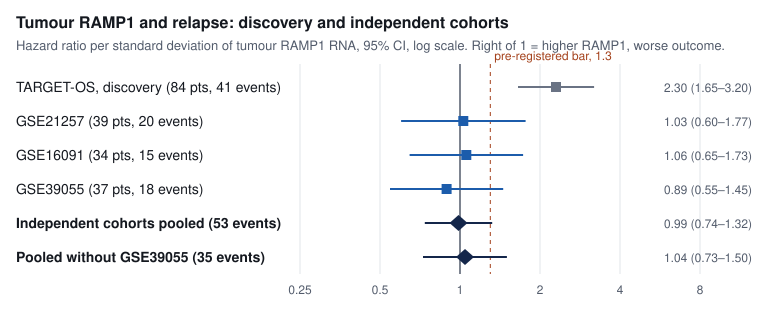

# Engine cycle 1: does RAMP1 predict relapse?

*Run November 24, 2026. The first cycle of the For John research engine: an idea generated from our own data, written down with its success and failure rules before new data were examined, then tested on patients it had never seen. Pre-registration: `research_notes/Engine/cycle-01-ramp1/PREREGISTRATION.md`, committed at 06:17 UTC (commit `ca12d5c`), with cohort choices recorded at 06:26 UTC (`2a24d3d`), both before any expression value was read. Script: `tools/engine_cycle01_ramp1.py`. Results: `data/engine/cycle01/results.csv`.*

## Summary

In the US TARGET-OS study, tumours with more RAMP1, part of the receptor that migraine drugs called gepants block, went with much earlier relapse. Among 12,753 genes it was the strongest such signal, which made it look like a new risk marker with an approved drug class attached. We tested it in three independent groups of patients, 110 in all with 53 relapses, metastases or deaths. The signal did not appear in any of them: the combined hazard ratio was 0.99, where the original study gave 2.30. By the rules written down in advance, the verdict is **inconclusive**, because the upper end of the confidence range, 1.32, sits just above the 1.3 needed to rule out a meaningful effect. But the large effect seen in TARGET-OS is ruled out. The most likely explanation is the one the plan anticipated: the top hit of a 12,753-gene scan in 84 patients is often a fluke. RAMP1 is not promoted to a lead.

**How to read the labels.** Every number here is **(our calculation)** from open data unless marked otherwise.

## What was tested

- **Hypothesis:** higher tumour RAMP1 RNA at diagnosis is associated with shorter time to relapse or metastasis, independently of metastasis at diagnosis.
- **Discovery (source of the idea, not evidence for it):** TARGET-OS, 84 patients with tumour RNA, 41 events. Re-run here from the open GDC files: hazard ratio **2.30 per standard deviation (95% CI 1.65–3.20), p = 7.4 × 10⁻⁷**, adjusted for metastasis at diagnosis. This matches the tournament's original figure exactly.
- **Independent cohorts:** all public cohorts meeting the pre-registered rules (tumour RNA before treatment, time-to-event outcome, no TARGET-OS patients), found by a systematic GEO search of 200 series:

| Cohort | Platform | Patients | End point | Events |
|---|---|---|---|---|
| GSE21257 (Leiden, pre-chemotherapy biopsies) | Illumina array | 39 without metastasis at diagnosis | Metastasis-free survival | 20 |
| GSE16091 | Affymetrix U133A | 34 | Overall survival (the only outcome recorded) | 15 |
| GSE39055 | Illumina DASL | 37 | Recurrence-free survival | 18 |

GSE39055 is one of the cohorts used by a 2023 paper reporting RAMP1 as a poor-prognosis marker (paper, abstract only; PMID 37796823). It is independent of TARGET-OS, so the plan includes it, and results are shown with and without it.

## Results

| Analysis | Patients | Events | Hazard ratio per SD (95% CI) | p |
|---|---|---|---|---|
| TARGET-OS, discovery | 84 | 41 | 2.30 (1.65–3.20) | 7.4 × 10⁻⁷ |
| GSE21257 | 39 | 20 | 1.03 (0.60–1.77) | 0.92 |
| GSE16091 | 34 | 15 | 1.06 (0.65–1.73) | 0.83 |
| GSE39055 | 37 | 18 | 0.89 (0.55–1.45) | 0.64 |
| **Independent cohorts pooled** | **110** | **53** | **0.99 (0.74–1.32)** | **0.93** |
| Pooled without GSE39055 | 73 | 35 | 1.04 (0.73–1.50) | — |

- The three cohorts agree with each other (I² = 0%); random-effects pooling gives the same 0.99 (0.74–1.32).
- **Verdict under the pre-registered rules: Inconclusive.** "Replicated" needed a lower bound above 1.0 and an estimate of at least 1.3. "Refuted" needed the upper bound below 1.3; it is 1.32. Without GSE39055 the result is also inconclusive, and underpowered (35 events, below the 48 set in advance).
- **What is excluded:** any effect as large as the discovery estimate. The pooled upper bound, 1.32, is far below the discovery's 2.30 and below the discovery's own lower bound, 1.65.

## Checks

- **Is RAMP1 measured?** Yes. On each array its chosen probe sits in the upper half of all probes by mean signal (53rd to 78th percentile), with a spread of 0.66–1.07 log₂ units between patients. In TARGET-OS RNA sequencing its median is about 20 transcripts per million. The null result is not a probe failure.
- **Overall survival in GSE21257** (secondary), all 53 patients adjusted for metastasis at diagnosis: 1.25 (0.78–2.01), p = 0.35.
- **Receptor partner.** CALCRL, which RAMP1 needs to form the CGRP receptor, showed no association in the discovery cohort (1.06, p = 0.75) or the pooled independent cohorts (0.89, 0.68–1.18). A CGRP-signalling explanation was already weak before the replication test.
- **Differentiation genes.** In TARGET-OS, SP7, a marker of bone-forming differentiation, also predicted events (2.25, p = 0.006). This supports the idea, raised by the tournament's reviewers, that RAMP1 was riding on a differentiation pattern in that cohort rather than acting on its own. Pooled across the independent cohorts, SP7 was 1.26 (0.88–1.79) and SOST 0.95 (0.65–1.39); neither reached significance.

## What this means

- **RAMP1 is not a lead.** It goes on the Research Queue as tested and inconclusive, with the discovery-size effect ruled out.
- **Prediction P15** is unresolved by its own rule (the upper bound missed 1.3 by 0.02) and is recorded as such, without rounding in either direction.
- **The 2023 paper.** We did not see the association in GSE39055's recurrence data. That paper may have used a different end point or a high/low cut-off rather than a continuous measure; we read only its abstract, so we do not claim it is wrong.
- **The engine worked as intended.** Without the advance rules, a p-value of 7 × 10⁻⁷ and an approved drug class would have made RAMP1 one of the project's most exciting leads. Testing it on new patients first cost a day and avoided sending a fluke to a laboratory.

## Limits

- Three small cohorts, two microarray platforms and three different end points. Arrays measure expression with less range than RNA sequencing, which can weaken a real association. Standardising each cohort helps but does not remove this.
- GSE16091 records only overall survival and none of the three records treatment in detail.
- An effect of hazard ratio about 1.3 per SD or smaller, which would be modest but not trivial, cannot be ruled out with 53 events. About 114 events would be needed.
- This concerns tumour RNA at diagnosis. It says nothing about RAMP1 protein, about nerve-derived CGRP in the tumour's surroundings, or about the effect of blocking the receptor.

## Files and reproduction

- `tools/engine_cycle01_ramp1.py` (uses the Cox and survival code in `tools/survival_analysis.py`).
- Inputs: TARGET-OS files as for `reports/Do the leads predict survival.md`; GEO series matrices and platform tables for GSE21257, GSE16091 and GSE39055 in `data/engine/cycle01/raw/` (downloaded November 24, 2026; large, not stored in git).
- Outputs: `data/engine/cycle01/results.csv`, `data/engine/cycle01/summary.json`, `docs/figures/engine01_ramp1_forest.svg`.

## Change log

- 2026-11-27: probe percentiles and one p-value corrected to match a recomputation.
- 2026-11-24: cycle run and reported. Verdict inconclusive under the pre-registered rules; discovery-size effect excluded.
