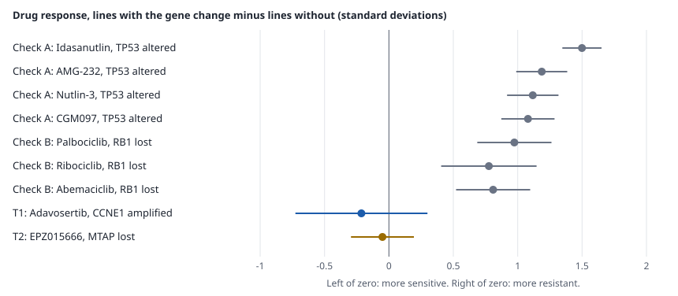

# Engine cycle 10: do the gene-change weaknesses hold up with real drugs?

*Run November 25, 2026. The tenth cycle of the For John research engine. Pre-registration: `research_notes/Engine/cycle-10-drug-screen/PREREGISTRATION.md`, committed at 17:43 UTC (commit `e601249`) before any drug-response file was downloaded. Script: `tools/engine_cycle10_prism.py`. Results: `data/engine/cycle10/results.csv`.*

## Summary

Earlier cycles used gene-knockout screens, which switch a gene off in cancer cells. Patients get drugs, not knockouts, so this cycle used a public drug screen (PRISM Repurposing, Broad Institute) to see whether those links also show up with real drugs.

- **The method works.** Both built-in checks passed clearly. Cell lines with a broken TP53 gene resisted all four MDM2 inhibitors, and lines that had lost RB1 resisted all three CDK4/6 inhibitors.
- **WEE1 inhibitor and CCNE1: inconclusive.** Lines with extra copies of CCNE1 were not clearly more sensitive to adavosertib. The difference was −0.21 standard deviations, with a range from −0.73 to +0.30. Only 16 lines were amplified, and the consistency checks did not agree with one another.
- **Early PRMT5 inhibitor and MTAP loss: inconclusive, and close to no effect.** The difference was −0.05 (−0.29 to +0.19). This fits the reason the MTAP trials use newer drugs built for MTAP-lost tumours, though it falls just short of ruling out a small effect.
- **Osteosarcoma lines (exploratory).** The screen has seven osteosarcoma lines, too few to test anything. SJSA-1, an osteosarcoma line with extra copies of MDM2 and working TP53, was among the most sensitive of several hundred lines to three of the four MDM2 inhibitors. That is the textbook case, not a discovery.

**How to read the labels.** Every number here is **(our calculation)** from open data unless marked otherwise.

## What was tested

- **Drug data:** PRISM Repurposing 20Q2, secondary screen. Hundreds of cancer cell lines were treated at eight doses, and the measure is the area under the dose-response curve (AUC), where lower means more killing. Where a drug was run in two batches, the MTS010 batch was used, as the dataset recommends. EPZ015666 is only in the primary screen, at one dose (2.5 µM), where the measure is the change in viability.
- **Gene changes:** DepMap 24Q4, with the same rules as cycles 5, 6 and 9.
- **Effect:** the difference between lines with the gene change and lines without, adjusted for cancer type. It is given in standard deviations of that drug's response, so that drugs can be compared. Negative means more sensitive.
- **Verdict rules, fixed in advance:**
  - Supported: −0.2 or lower, with the whole 95% interval below zero.
  - Refuted: the whole interval above −0.2.
  - Inconclusive: anything else.

## Results

| Step | Drug | Gene change | Lines (with the change) | Difference, SD (95% CI) | Outcome |
|---|---|---|---|---|---|
| Check A | Idasanutlin | TP53 altered | 497 (301) | +1.50 (+1.35 to +1.65) | resistant, as expected |
| Check A | AMG-232 | TP53 altered | 438 (306) | +1.19 (+0.99 to +1.39) | resistant, as expected |
| Check A | Nutlin-3 | TP53 altered | 440 (306) | +1.12 (+0.92 to +1.32) | resistant, as expected |
| Check A | CGM097 | TP53 altered | 425 (292) | +1.08 (+0.87 to +1.29) | resistant, as expected |
| Check B | Palbociclib | RB1 lost | 652 (50) | +0.97 (+0.69 to +1.26) | resistant, as expected |
| Check B | Ribociclib | RB1 lost | 576 (32) | +0.78 (+0.41 to +1.15) | resistant, as expected |
| Check B | Abemaciclib | RB1 lost | 661 (52) | +0.81 (+0.52 to +1.10) | resistant, as expected |
| **T1** | **Adavosertib (WEE1)** | **CCNE1 amplified** | **631 (16)** | **−0.21 (−0.73 to +0.30)** | **Inconclusive** |
| **T2** | **EPZ015666 (early PRMT5)** | **MTAP lost** | **473 (87)** | **−0.05 (−0.29 to +0.19)** | **Inconclusive** |

- **Check A passed (4 of 4) and Check B passed (3 of 3).** The CDK4/6 result was not guaranteed: these drugs mostly slow cells rather than kill them, and the screen lasts five days. The screen detected it anyway.
- **T1 is not underpowered by the rule set in advance** (16 amplified lines, above the 10 required). It is still too small to tell a modest effect from none. The amplified lines come mostly from stomach and oesophagus, uterus, lung, ovary and breast cancers.
- **T2's interval reaches −0.29,** just past the −0.2 line, so a small effect is not ruled out. The point estimate is close to zero.

**Consistency checks for T1** (the same laboratory and mostly the same lines, so these are not independent):

| Version | Difference, SD (95% CI) |
|---|---|
| Other screen batch (HTS002, 10 amplified lines) | −0.39 (−1.04 to +0.26) |
| Primary screen, one dose | +0.02 (−0.49 to +0.53) |
| CCNE1 RNA instead of amplification (per log2 unit) | +0.03 (−0.06 to +0.12) |
| Without the cancer-type adjustment | −0.23 (−0.73 to +0.27) |

The two dose-response batches lean the expected way. The single-dose screen and the RNA measure do not.

## Osteosarcoma lines (exploratory, not a test)

Seven osteosarcoma lines are in the screen: 143B, G-292, HOS, MG-63, Saos-2, SJSA-1 and U-2 OS. 143B was derived from HOS, so the two are not independent. None has CCNE1 amplification by the rule used here. By DepMap's calls, HOS and 143B have lost MTAP, Saos-2 has lost RB1, and HOS, 143B and Saos-2 have altered TP53. As cycle 9 showed, these calls miss genes broken by large rearrangements, which is how osteosarcoma often loses TP53.

The full per-line table is in `data/engine/cycle10/osteosarcoma_lines.csv`. Each value is the line's position among all lines tested with that drug, where 0 means the most sensitive and 1 the least.

- **MDM2 inhibitors:**
  - SJSA-1 ranked at 0.03 (AMG-232), 0.02 (nutlin-3), 0.04 (CGM097) and 0.15 (idasanutlin).
  - SJSA-1 is a well-known osteosarcoma line with MDM2 amplification and working TP53 (general knowledge). So this is the expected result, and a check that the line behaves as described.
  - Saos-2, which has lost TP53, was tested with only one MDM2 inhibitor (idasanutlin), where it ranked at 0.47.
- **The kinase pills tested in osteosarcoma trials:**
  - MG-63 was among the most sensitive lines to several of them (cabozantinib 0.00, apatinib 0.01, anlotinib 0.05, pazopanib 0.07, sunitinib 0.11) but showed no measurable response to sorafenib or regorafenib (AUC 1.0, the maximum).
  - The other osteosarcoma lines were spread across the range.
  - These drugs share targets, so this is one observation about one line, not five.
  - As stated before the data were opened, these drugs are thought to act largely on a tumour's blood vessels, which cells in a dish lack. Neither strong nor weak activity here says how they work in patients.

## What this means

- **The drug screen can see real drug–gene links.** Both checks were large and clear, so the inconclusive tests are not a failure of the method.
- **CCNE1 and WEE1: no support from drug data at this size.** The knockout screen in cycle 6 also found no link between CCNE1 and WEE1, though across all cancers it did find one between CCNE1 and PKMYT1 or CDK2. Neither result counts against the CCNE1 trials, whose drugs were chosen on other evidence, but this project cannot add support. The direct test is still a laboratory one: queue row 15, with the four CCNE1-amplified osteosarcoma lines found in cycle 6, none of which is in this screen.
- **The early PRMT5 drug shows little or no MTAP effect,** which fits why the trials in cycle 4 use newer drugs designed for MTAP-lost tumours. This screen does not contain those newer drugs, so it cannot test them.
- **Predictions:** P29 and P30 are right. P31 and P32 are unresolved by their own rules.

## Limits

- Cell lines in a dish lack the immune system, blood vessels and bone surroundings of a real tumour, and five days is short.
- Only 16 lines with CCNE1 amplification had adavosertib data.
- The newer drugs that matter most for this project (MTAP-selective PRMT5 inhibitors, PKMYT1 and CDK2 inhibitors) are not in the screen.
- The two screen batches and the single-dose screen come from the same laboratory, so their agreement or disagreement is not independent replication.
- The gene-change calls use one rule each and miss genes broken by rearrangements.

## Files and reproduction

- `python3 tools/engine_cycle10_prism.py fetch` downloads the PRISM files (about 340 megabytes, not stored in git) into `data/engine/prism/raw/`.
- `python3 tools/engine_cycle10_prism.py` runs the analysis. It also needs the DepMap 24Q4 files fetched by `tools/engine_cycle05_06_depmap.py` and `tools/engine_cycle09_suppressor_scan.py`.
- Outputs: `data/engine/cycle10/results.csv`, `data/engine/cycle10/osteosarcoma_lines.csv`, `data/engine/cycle10/summary.json` and `docs/figures/engine10_drugs.svg`.

**Data sources and credit.**
- PRISM Repurposing 20Q2 (Broad Institute; Corsello et al., Nature Cancer 2020), from Figshare article 20564034.
- DepMap 24Q4 Public (Broad Institute), from Figshare article 27993248.

## Change log

- 2026-11-26: after an independent check, MG-63's results for sorafenib and regorafenib added, and the cycle 6 comparison qualified as "across all cancers".
- 2026-11-25: cycle run and reported. Verdicts under the pre-registered rules: both checks passed; T1 and T2 inconclusive. No deviations from the pre-registration.
