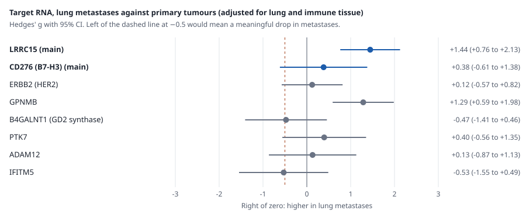

# Engine cycle 11: do lung metastases keep the surface targets that new drugs aim at?

*Run November 25, 2026. The eleventh cycle of the For John research engine. Pre-registration: `research_notes/Engine/cycle-11-targets-in-metastases/PREREGISTRATION.md`, committed at commit `bc9e66a` before any of these genes was read from the data. Script: `tools/engine_cycle11_targets.py`. Results: `data/engine/cycle11/results.csv`.*

## Summary

New osteosarcoma drugs aimed at the surface proteins LRRC15 and B7-H3 (gene CD276) are tested mostly in patients whose disease has spread to the lungs. The evidence for those targets, however, comes mostly from primary tumours. We compared target RNA in 29 lung metastases with 51 primary tumours across six public datasets.

- **LRRC15: "Maintained" by the pre-registered rule, but less firmly than that label suggests.**
  - No version of the analysis shows a clear drop of LRRC15 in lung metastases, though the three sensitivity datasets (metastasis site not recorded) leaned lower (−0.42, −0.88 to +0.04).
  - The measure the rule used, though, turned out to be unstable, for the reason explained below.
- **B7-H3: inconclusive.**
  - Whole-tissue samples of lung metastases had less B7-H3 RNA than primary tumours.
  - Once lung tissue was accounted for, and in tumour cells alone, there was no clear drop.
  - So the lower whole-tissue value may come from normal lung diluting the sample, but this cannot be settled with four tumour-cell samples.
- **Predictions:** P33 (LRRC15 maintained) is right and P34 (B7-H3 maintained) is wrong, both by their own rules. P34 is the engine's first wrong prediction.
- **The lesson for the method:** adjusting for lung tissue does not work well when lung tissue almost perfectly separates the two groups. The next test of this kind should rely on tumour cells measured directly.

**How to read the labels.** Every number here is **(our calculation)** from open data unless marked otherwise.

## What was tested

- **Data:** the six datasets of engine cycle 2, which compare lung metastases with primary tumours. They contain 29 lung-metastasis samples and 51 primary-tumour samples, measured by microarray, bulk RNA sequencing, spatial sequencing and single-cell sequencing.
- **Measure:** the difference in standard deviations (Hedges' g), lung metastasis minus primary, pooled across datasets. Negative means lower in metastases.
- **The pre-registered primary measure** was adjusted for a lung score (three normal-lung genes) and an immune score. This was meant to remove the dilution caused by normal lung and immune cells in a metastasis sample.
- **Verdict rules, fixed in advance:**
  - "Maintained": the lower end of the 95% interval is above −0.5.
  - "Lower in metastases": −0.5 or lower with the whole interval below zero, unless tumour cells alone show no drop.
  - "Inconclusive": anything else.

## Results

*The figure shows the pre-registered adjusted measure, which proved unstable (see below). The table gives the unadjusted and tumour-cell values alongside.*

| Gene | Pre-registered measure: adjusted for lung and immune tissue | Unadjusted | Tumour cells only (4 v 11 samples) | Matched pairs (4 patients) | Verdict |
|---|---|---|---|---|---|
| **LRRC15** | +1.44 (+0.76 to +2.13) | −0.22 (−0.70 to +0.27) | −0.25 (−1.41 to +0.91) | −0.01 (−0.77 to +0.74) | **Maintained** |
| **CD276 (B7-H3)** | +0.38 (−0.61 to +1.38) | −0.79 (−1.31 to −0.26) | −0.12 (−1.28 to +1.05) | −0.75 (−1.15 to −0.35) | **Inconclusive** |
| ERBB2 (HER2) | +0.12 (−0.57 to +0.82) | +0.54 (+0.06 to +1.03) | +0.26 (−0.91 to +1.43) | +0.77 (+0.01 to +1.53) | Inconclusive |
| GPNMB | +1.29 (+0.59 to +1.98) | −0.34 (−0.83 to +0.15) | −0.56 (−1.96 to +0.85) | −0.35 (−0.97 to +0.27) | Maintained |
| B4GALNT1 (GD2 synthase) | −0.47 (−1.41 to +0.46) | −0.33 (−0.81 to +0.15) | −0.47 (−1.65 to +0.72) | +0.42 (−0.19 to +1.03) | Inconclusive |
| PTK7 | +0.40 (−0.56 to +1.35) | +0.22 (−0.26 to +0.69) | +0.65 (−0.53 to +1.82) | −0.20 (−0.41 to +0.01) | Inconclusive |
| ADAM12 | +0.13 (−0.87 to +1.13) | −0.57 (−1.05 to −0.08) | −0.85 (−2.05 to +0.34) | −0.58 (−1.19 to +0.04) | Inconclusive |
| IFITM5 | −0.53 (−1.55 to +0.49) | −0.64 (−1.16 to −0.12) | −1.58 (−2.91 to −0.26) | −0.03 (−1.26 to +1.21) | Inconclusive |

The first two rows are the main tests. The other six were pre-registered as a secondary set. CD276 and IFITM5 are missing from the oldest microarray, so those rows use 25 metastases against 46 primaries.

- **The built-in check passed.** The lung score was far higher in lung metastases (g +3.23, +2.47 to +3.98), as in cycle 2, which shows the samples loaded correctly.

## Why the adjusted measure is unstable (not in the plan; found while checking)

The adjustment was carried over from cycle 2. It removes, within each dataset, the part of a gene's signal that tracks the lung and immune scores. That works when the two groups overlap in lung content. Here they barely overlap: in every dataset metastasis samples carry far more normal lung (lung score differences of 1.2 to 19.9 standard deviations). The adjustment therefore has to extrapolate, and small datasets can swing hard.

- **For LRRC15:**
  - The adjusted result leans on one single-cell dataset with six samples (GSE318840: +1.95, standard error 0.43). Without it, the adjusted estimate is +0.49 (−0.66 to +1.65), which is no longer "Maintained" by the rule.
  - Adjusting for the immune score alone gives +0.07 (−0.43 to +0.57), which would be.
- **For CD276:**
  - The immune-only adjustment gives −0.71 (−1.26 to −0.15).
  - The lung-only adjustment gives +0.09 (−0.86 to +1.04).

These checks were not in the plan. They are reported so that the verdicts are not read as stronger than they are.

## What this means

- **LRRC15:**
  - No analysis showed a clear drop of LRRC15 in lung metastases. The unadjusted, immune-adjusted, tumour-cell and matched-pair versions are all near zero.
  - The pre-registered sensitivity analysis of the three datasets whose metastasis site is not recorded leaned lower (−0.42, −0.88 to +0.04), and one main dataset, GSE293065, gave −0.94 (−1.89 to +0.01).
  - In the single-cell data, the median share of tumour cells with any LRRC15 reads was 12% in four metastases and 7% in eleven primaries.
  - So there is no clear sign that this target is lost where relapsed osteosarcoma grows, but a modest drop is not ruled out. This is RNA, not protein, and the strict test is less certain than its label.
- **B7-H3:**
  - Whole-tissue metastasis samples had less B7-H3 RNA, including within the same patients (four pairs).
  - In tumour cells alone, there was no clear drop: the median share of tumour cells with reads was 28% in metastases and 20% in primaries.
  - If B7-H3 is lower in lung metastases, the difference may lie in the tissue around the tumour rather than in the tumour cells. A protein stain of matched primary tumours and metastases would settle it. This is the same kind of partner study as queue row 8.
- **Secondary set (exploratory weight):**
  - No gene met "Lower in metastases".
  - GPNMB's "Maintained" rests on the same unstable adjustment as LRRC15's. Under the immune-only adjustment, GPNMB (−0.58, −1.03 to −0.12), CD276 (−0.71, −1.26 to −0.15), B4GALNT1 (−0.57, −1.04 to −0.10) and ADAM12 (−0.86, −1.37 to −0.36) would read lower in metastases. All these checks are saved in `data/engine/cycle11/posthoc_checks.json`.
  - IFITM5, one of this project's own surface leads, was lower in tumour cells of the four metastases (−1.58, −2.91 to −0.26). With four samples this is a flag to check, not a finding.
  - It adds to the doubts about IFITM5 already listed in `reports/New surface targets for osteosarcoma.md`.
- **For the method:** a future cycle comparing metastases with primaries should make tumour cells measured directly (single-cell or stained tissue) the primary measure, and use whole-tissue adjustment only as support.

## Limits

- RNA is not protein, and the drugs bind protein.
- Only four lung metastases have single-cell data.
- The datasets differ in technology, and some primary and metastasis samples come from different patients.
- The adjusted measure is unstable, as described above.
- "Maintained" means that a drop of half a standard deviation was ruled out on that measure. It does not mean the two are the same.

## Files and reproduction

- `bash tools/engine_cycle02_fetch.sh` downloads the datasets (as for cycle 2).
- `python3 tools/engine_cycle11_targets.py` runs the analysis.
- Outputs:
  - `data/engine/cycle11/results.csv`, `summary.json` and `tumour_cells.csv` (per-sample tumour-cell values and the share of cells with reads);
  - `docs/figures/engine11_targets.svg`.

**Data sources and credit.** NCBI GEO series GSE14359, GSE220538, GSE140131, GSE293065, GSE152048, GSE318840, GSE32981, GSE237033 and GSE87624. These are the same sources and credits as engine cycle 2.

## Change log

- 2026-11-26: after an independent check, LRRC15 wording softened to "no clear drop"; the pre-registered sensitivity result (−0.42) and the immune-only readings for GPNMB and CD276 added; the checks outside the plan saved to `posthoc_checks.json`.
- 2026-11-25: cycle run and reported. Verdicts under the pre-registered rules: LRRC15 and GPNMB maintained; CD276 and the other five inconclusive. No deviation from the plan. The instability of the adjusted measure was found afterwards and is reported as a check outside the plan.
