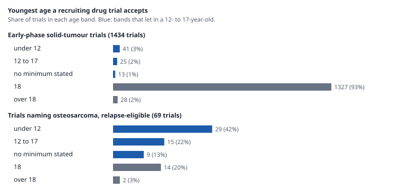

# Engine cycle 12: across the whole trial registry, how often can a teenager with osteosarcoma get into a drug trial?

*Run November 26, 2026. The twelfth cycle of the For John research engine. Pre-registration: `research_notes/Engine/cycle-12-teen-access/PREREGISTRATION.md`, committed at commit `b9ce5c9` before the registry was searched. Script: `tools/engine_cycle12_teen_access.py`. Results: `data/engine/cycle12/`. Based on ClinicalTrials.gov records read on November 26, 2026. Not medical advice; whether a trial suits a patient is a question for that patient's care team.*

## Summary

Cycles 4 and 7 found that the targeted-drug trials for two gene changes in osteosarcoma almost all start at 18. This cycle asked the same question across the whole registry, and the answer has two sides.

- **Trials that list osteosarcoma usually take teenagers.**
  - 58 recruiting or soon-to-recruit drug trials list osteosarcoma and take patients whose disease has come back or not responded. 44 of them (76%) accept 12- to 17-year-olds, and 32 of those have a US site.
  - Many of the 58 are wider sarcoma or childhood-cancer trials; 19 have osteosarcoma in the title.
- **The broad "solid tumour" trials, where most new drugs first enter people, rarely do (5.4%).**
  - Of 1,434 early-phase drug trials for solid tumours (recruiting or not yet recruiting), 78 (5.4%) accept 12- to 17-year-olds, and 38 (2.6%) do so with a US site.
  - 1,327 (93%) start at exactly 18.
- **Who opens the door.**
  - Companies lead 77% of those trials but only 37% of the ones that accept teenagers.
  - 16 of the 1,434 (1.1%) are company-led, accept teenagers and have a US site.
- **What it means.** A teenager with relapsed osteosarcoma can usually find trials that list osteosarcoma. But the newest drugs, which reach people first through adult "any solid tumour" trials, mostly reach teenagers late. This fits what cycles 4 and 7 found for two drug classes.
- **Predictions:** all three were right (P35, P36, P37).

**How to read the labels.** Every number here is **(our calculation)** from **(registry)** records unless marked otherwise.

## What was counted

Both sets were limited to trials that were interventional, recruiting or not yet recruiting, and tested at least one drug, biological or genetic product. That includes antibodies, antibody–drug conjugates, radioligands, vaccines and cell therapies.

- **Set A, trials naming osteosarcoma.**
  - Found by the registry's condition search for "osteosarcoma" and kept only if the word appears in the record: 72 trials.
  - The pre-registered text rule flagged 69 as open to relapsed disease.
  - Every one of the 72 was then classified by reading its record. The plan called for a sample of 30; the full read is a step beyond the plan, taken because the sample showed the rule over-counting.
  - The reading was done by a frontier AI model working on this project, as a single reader. An independent check afterwards found one error (the OstEvo trial, NCT07477457, has a cohort for relapsed disease), now corrected.
  - After that correction, 58 are treatment trials open to relapsed or refractory osteosarcoma.
- **Set B, early-phase solid-tumour trials.**
  - Phase 1, 1/2 or 2 trials (including 16 phase 2/3 trials; see Deviations) with a condition reading "solid tumor", "solid tumour" or "solid neoplasm", excluding Set A: 1,434 trials.
  - Whether each would accept osteosarcoma was not read. Set B describes the trials' age limits, not osteosarcoma eligibility.
- **Accepts teenagers:** the minimum age is 17 or younger (or none is given) and any maximum age is 12 or older.

## Results

*The osteosarcoma bars use the pre-registered text rule (53 of 69 trials accept teenagers); reading each record gives 44 of 58. One trial in the "under 12" bar of the solid-tumour set is the registry age error noted below.*

| Measure | Count | Share (95% CI) |
|---|---|---|
| **Set A, by reading each record:** relapse-eligible treatment trials listing osteosarcoma | 58 | |
| accept teenagers | 44 | 76% (63–85%) |
| accept teenagers and have a US site | 32 | 55% |
| Set A, by the pre-registered text rule: relapse-eligible | 69 | |
| accept teenagers | 53 | 77% (66–85%) |
| **Set B:** early-phase solid-tumour drug trials | 1,434 | |
| accept teenagers | 78 | 5.4% (4.4–6.7%) |
| accept teenagers and have a US site | 38 | 2.6% (1.9–3.6%) |
| start at exactly 18 | 1,327 | 93% |
| company-led, among all | 1,097 | 77% (74–79%) |
| company-led, among those accepting teenagers | 29 of 78 | 37% (27–48%) |
| company-led, accepting teenagers, with a US site | 16 | 1.1% |

**The hand check.**
- The text rule agreed with the reading in 23 of the 30 trials in the pre-registered random sample, and in 59 of all 72.
- Its errors were almost all one way: it counted newly diagnosed, first-line or unrelated trials as relapse trials. That happened because words like "metastatic" and "progression" also appear in first-line trials. Two trials named osteosarcoma only by mistake or in an exclusion: a liver-cancer trial and a soft-tissue sarcoma trial.
- The reading changes the headline share by about one point (77% to 76%).
- The hand classification, with a note for each excluded trial, is in `data/engine/cycle12/hand_classification.csv`.

**The 14 relapse trials naming osteosarcoma that start at 18 or older.**
- 5 are company-led, including two trials of HS-20093, an antibody–drug conjugate aimed at B7-H3. One is mainly for relapsed osteosarcoma, with other sarcomas also eligible, and has sites in China only (NCT05830123); the other lists no sites yet.
- 9 are led by universities or hospitals, including two US trials of zanzalintinib in bone sarcoma (NCT06571734, NCT07193550). A separate, company-run trial of the same drug in children and adolescents takes patients from 12 months (NCT07773454); it was not yet open on the day of the search and listed no sites.
- The others are listed in `data/engine/cycle12/set_a.csv`.

## Checks and caveats

- **Set B mixes adult and children's trials.** Its 78 teenager-accepting trials include children's cancer trials (40 start under age 12). One more trial with a floor under 12 in the figure is a registry entry error: its ages read "18 Days" to "75 Days" (NCT06342336), clearly meant as years; it is counted as not accepting teenagers. Among adult new-drug trials alone, the share open to teenagers is lower still.
- **"Accepts teenagers" reads only the registry's age fields.** Some trials also need a minimum weight, adult dosing first, or a particular disease group. Lunresertib, for example, takes under-18s only above 40 kg (cycle 7).
- **The searches depend on the registry's condition terms.** A trial that never uses "osteosarcoma" or "solid tumor" is missed. The counts are snapshots of one day, and only ClinicalTrials.gov was searched.
- **A trial that accepts teenagers is not necessarily open to a given patient.** Each has further rules, and many are early dose-finding studies.

## What this means

- **For families:**
  - Trials that list osteosarcoma usually accept teenagers.
  - About half of the relapse trials listing osteosarcoma have a US site and accept teenagers.
  - The registry and the care team remain the place to check, as the For Families page says.
- **For the brief and its asks:**
  - The gap is in the first trials of new drugs, which are run mostly by companies and almost always start at 18.
  - The trial-access brief's request, to open tumour-agnostic trials to patients aged 12 and over once adult dosing data allow, applies well beyond the two drug classes it started from.
- **Not shown here:** why each trial set its age limit. The reasons in the brief (no paediatric dosing yet, early safety studies) apply to many of these trials.

## Deviations

- **Phase filter.** The plan said phase 1, 1/2, early phase 1 or 2. The code kept any trial with one of those phases, so 16 phase 2/3 trials entered Set B. Without them, 72 of 1,418 accept teenagers (5.1%); no conclusion changes.
- **Full reading of Set A,** beyond the planned 30-trial sample, as described above.

## Files and reproduction

- `python3 tools/engine_cycle12_teen_access.py fetch` searches ClinicalTrials.gov. Raw records go to `data/engine/cycle12/raw/`, which is not in git because the records include trial staff contact details.
- `python3 tools/engine_cycle12_teen_access.py` builds the outputs:
  - `data/engine/cycle12/set_a.csv`, `set_b.csv`, `hand_check_sample.csv` and `summary.json`;
  - `docs/figures/engine12_ages.svg`.
- `data/engine/cycle12/hand_classification.csv` holds the hand reading. A re-run on a later day will find a different registry.

**Data source.** ClinicalTrials.gov API v2 (US National Library of Medicine).

## Change log

- 2026-11-28: "almost never" changed to "rarely (5.4%)", to match the other pages.
- 2026-11-27: after a second independent check, the title count corrected (19, not 18) and the figure's basis stated.
- 2026-11-26: corrected after an independent check. One trial (NCT07477457) reclassified as relapse-eligible: 58 trials, 44 accepting teenagers, 32 with a US site (was 57, 43, 31). Wording changed from "anyone under 18" to "12- to 17-year-olds" to match the definition; the inclusion of phase 2/3 trials declared as a deviation; the 40 children's trials and one registry age error described.
- 2026-11-26: cycle run and reported. All three predictions right. The full hand classification of Set A goes beyond the pre-registered 30-trial sample. It is reported alongside the rule's result, which was kept as planned.
