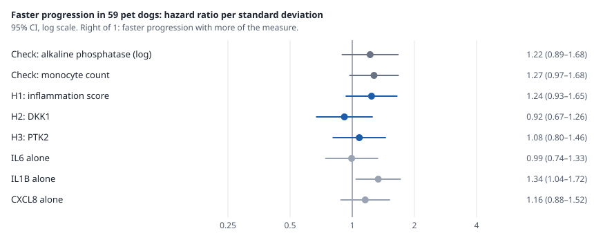

# Engine cycle 13: in pet dogs with osteosarcoma, does tumour inflammation go with faster relapse?

*Run November 26, 2026. The thirteenth cycle of the For John research engine. Pre-registration: `research_notes/Engine/cycle-13-dog-inflammation/PREREGISTRATION.md`, committed at commit `4e10b3b` before any expression value was read. Script: `tools/engine_cycle13_dog_inflammation.py`. Results: `data/engine/cycle13/results.csv`.*

## Summary

Two of this project's leads propose drug trials in pet dogs with osteosarcoma:
- **Lead 1:** blocking IL-1 or IL-6 after amputation;
- **Lead 4:** blocking FAK or DKK1.

We asked whether dogs whose tumours carried more of these signals before treatment relapsed sooner. The data come from a public trial of 59 dogs treated with amputation and chemotherapy, 47 of whom progressed or died during follow-up.

- **Inflammation score (IL6, IL1B, CXCL8): inconclusive.** Hazard ratio 1.24 per standard deviation (95% CI 0.93–1.66). It leans towards faster relapse but could be chance.
- **DKK1: refuted** by the pre-registered rule: 0.92 (0.67–1.26). Dogs with more tumour DKK1 RNA did not relapse faster; an effect of 1.3 or more is ruled out.
- **PTK2 (FAK): inconclusive:** 1.08 (0.80–1.46).
- **The built-in check was weak.** Serum alkaline phosphatase, a long-known bad sign in dogs, leaned the expected way (1.22, 0.89–1.68) without reaching clarity. These 59 dogs are a small sample.
- **An exploratory flag, not a result:** IL1B on its own leaned towards faster relapse (1.34, 1.04–1.72). It is one of four single genes looked at as a secondary analysis, with no correction for multiple tests.
- **Predictions:** P38, P39 and P40 were all wrong. The scorecard records them.

**What it does and does not say about the leads.**
- Tumour RNA before treatment is not the same as inflammation in the body after surgery, which is what lead 1 is about. So this neither supports nor undermines the idea of blocking IL-1 or IL-6 after amputation.
- For lead 4, tumour DKK1 RNA does not mark the dogs that do worse. That removes one possible way of choosing dogs for a DKK1 trial. It does not test whether blocking DKK1 works.

**How to read the labels.** Every number here is **(our calculation)** from open data unless marked otherwise.

## What was tested

- **Data:** GEO GSE180303, a prospective trial in pet dogs with limb osteosarcoma.
  - Treatment: amputation, then carboplatin and/or doxorubicin.
  - Samples: pre-treatment tumour biopsies on Affymetrix Canine 2.0 arrays, two per dog (109 arrays, 59 dogs), averaged per dog.
- **Outcome:** time to progression.
  - The dataset gives no censoring flag, so a rule was fixed in advance. Dogs whose progression time equals their survival time and is a year or more were treated as alive and progression-free at last follow-up. All others were counted as events.
  - That gave 47 events. 40 dogs progressed or died within a year.
- **Measures:** RNA of the lead genes, as a hazard ratio per standard deviation from a Cox model.
- **Verdict rules, fixed in advance:**
  - Supported: the whole 95% interval is above 1.
  - Refuted: the upper end is below 1.3.
  - Inconclusive: anything else.

## Results

| Measure | Hazard ratio per SD (95% CI) | One-year odds ratio per SD (95% CI) | Verdict |
|---|---|---|---|
| Check: alkaline phosphatase (log) | 1.22 (0.89–1.68) | 1.35 (0.74–2.46) | weak |
| Check: monocyte count | 1.28 (0.97–1.68) | 1.82 (0.87–3.77) | weak |
| **H1: inflammation score (IL6, IL1B, CXCL8)** | **1.24 (0.93–1.66)** | 1.39 (0.77–2.51) | **Inconclusive** |
| **H2: DKK1** | **0.92 (0.67–1.26)** | 0.71 (0.40–1.24) | **Refuted** |
| **H3: PTK2 (FAK)** | **1.08 (0.80–1.46)** | 1.11 (0.64–1.93) | **Inconclusive** |
| IL6 alone | 0.99 (0.74–1.33) | 1.02 (0.59–1.77) | secondary |
| IL1B alone | 1.34 (1.04–1.72) | 2.16 (0.98–4.79) | secondary |
| CXCL8 alone | 1.16 (0.88–1.52) | 1.14 (0.65–1.98) | secondary |
| IL1A alone | 0.93 (0.66–1.31) | 0.85 (0.49–1.45) | secondary |

- **Sensitivity check:** leaving out the nine dogs whose event is least certain (progression time under a year, equal to survival time), the inflammation score gives 1.24 (0.89–1.74).
- **Adjusted for alkaline phosphatase:** 1.19 (0.87–1.61).
- **DKK1 and PTK2** were unchanged by either.

## What this means

- **For lead 1 (IL-1 or IL-6 after amputation in dogs):**
  - The tumour signal leans the expected way without being clear. The one gene that stood out on its own is IL1B, the gene for IL-1β.
  - That is a weak, unplanned pointer. It fits the IL-1 half of the lead and is worth testing in a second dog dataset with outcomes.
  - It is not evidence that blocking IL-1 would help.
- **For lead 4 (FAK or DKK1 in dogs):**
  - Neither gene's tumour RNA marked the dogs that did worse. In people, this project found only a weak, non-significant trend for DKK1 (`reports/Do the leads predict survival.md`).
  - Tumour DKK1 RNA should not be used to pick dogs or patients for a DKK1 trial.
- **The weak check matters.** Alkaline phosphatase is one of the best-known prognostic signs in dogs with osteosarcoma (general knowledge), and here it was only a lean. With 59 dogs, moderate real effects can be missed. "Inconclusive" here means just that.

## Limits

- 59 dogs from one trial, treated with two chemotherapy schedules.
- The censoring rule is an assumption; the dataset does not say which dogs were still alive.
- Tumour RNA from one biopsy, on an older array design.
- Several measures were tested. Only H1 was the main test, and the single-gene results are uncorrected.

## Files and reproduction

- `python3 tools/engine_cycle13_dog_inflammation.py fetch` downloads the series matrix and platform annotation from GEO (about 23 megabytes, not in git).
- `python3 tools/engine_cycle13_dog_inflammation.py` runs the analysis in seconds.
- Outputs: `data/engine/cycle13/results.csv`, `data/engine/cycle13/summary.json` and `docs/figures/engine13_dogs.svg`.

**Data source and credit.** NCBI GEO series GSE180303, a prospective clinical trial of gene-expression models of drug response in dogs with osteosarcoma (submitted by Colorado State University; PubMed 34263337 and 34635775).

## Change log

- 2026-11-26: cycle run and reported. Under the pre-registered rules: H1 inconclusive, H2 refuted, H3 inconclusive. The alkaline-phosphatase check leaned the expected way without reaching clarity. P38 to P40 wrong. No deviations.
