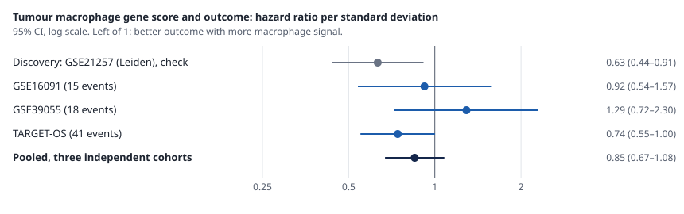

# Engine cycle 14: does more macrophage signal in the tumour go with a better outcome, in patients outside the study that found it?

*Run November 26, 2026. The fourteenth cycle of the For John research engine. Pre-registration: `research_notes/Engine/cycle-14-macrophages/PREREGISTRATION.md`, committed at commit `d79cc23` before any of these genes was read from these cohorts. Script: `tools/engine_cycle14_macrophages.py`. Results: `data/engine/cycle14/results.csv`. Nothing here is about any patient's treatment.*

## Summary

A 2011 Leiden study reported that osteosarcomas with more macrophages, a type of immune cell, had fewer metastases (paper, abstract; Buddingh et al., Clinical Cancer Research 2011). That is part of the rationale for immune-stimulating treatment such as mifamurtide. We tested a macrophage gene score (CD163, CD14, CD68) in three cohorts that played no part in that finding: 155 patients and 74 events.

- **The original result reproduces in its own data.** In the Leiden cohort (GSE21257), more macrophage signal went with longer metastasis-free survival: hazard ratio 0.63 per standard deviation (0.44–0.91). This shows the gene score captures what the study saw.
- **In new patients it is weaker and not clear.** Pooled across the three independent cohorts, the hazard ratio was 0.85 (0.67–1.08). The pre-registered verdict is **inconclusive**.
  - TARGET-OS leaned the same way (0.74, 0.55–1.00).
  - GSE16091 was near no effect (0.92), and GSE39055 leaned the other way (1.29).
- **T-cell score (secondary): also inconclusive,** 0.82 (0.63–1.06).
- **Predictions:** P41 (the reproduction) was right; P42 (independent support) was wrong.

This repeats the lesson of cycle 1: a clear result in one cohort often shrinks in new patients. The macrophage link is not ruled out; a protective effect of about 0.77 per standard deviation is still possible. But it is not confirmed in independent RNA data.

**How to read the labels.** Every number here is **(our calculation)** from open data unless marked otherwise.

## What was tested

- **Score:** the mean of the within-cohort z-scores of CD163, CD14 and CD68 RNA, from whole tumour pieces.
- **Cohorts, end points and probe rules:** those of engine cycle 1.
  - GSE21257: metastasis-free survival in patients without metastasis at diagnosis.
  - GSE16091: overall survival.
  - GSE39055: recurrence-free survival.
  - TARGET-OS: event-free survival, adjusted for metastasis at diagnosis.
- **Effect:** hazard ratio per standard deviation, pooled across the three independent cohorts (fixed effect). Below 1 means a better outcome with more macrophage signal.
- **Verdict rules, fixed in advance:**
  - Supported: the whole 95% interval is below 1.
  - Refuted: the lower end is above 0.77.
  - Inconclusive: anything else.

## Results

| Cohort | Patients (events) | Macrophage score | T-cell score (CD3E, CD8A) | CD163 alone |
|---|---|---|---|---|
| GSE21257, Leiden (where the finding came from) | 39 (20) | 0.63 (0.44–0.91) | 0.58 (0.33–1.02) | 0.59 (0.42–0.84) |
| GSE16091 | 34 (15) | 0.92 (0.54–1.57) | 1.07 (0.65–1.73) | 0.84 (0.49–1.45) |
| GSE39055 | 37 (18) | 1.29 (0.72–2.30) | 0.97 (0.61–1.54) | 0.92 (0.56–1.54) |
| TARGET-OS | 84 (41) | 0.74 (0.55–1.00) | 0.60 (0.40–0.89) | 0.69 (0.50–0.95) |
| **Pooled, three independent cohorts** | **155 (74)** | **0.85 (0.67–1.08)** | **0.82 (0.63–1.06)** | **0.77 (0.60–0.98)** |

- **Heterogeneity:** I² = 30% for the macrophage score. Random effects: 0.89 (0.65–1.21).
- **Without TARGET-OS** (the two GEO cohorts only): 1.08 (0.73–1.59).
- **In the Leiden cohort, overall survival adjusted for metastasis at diagnosis** (all 53 patients): 0.96 (0.65–1.41). The reproduction holds for metastasis, the end point the original study used, but not clearly for death.
- **CD163 alone** pooled to 0.77 (0.60–0.98). This is a secondary analysis, one of five single genes, with no correction for multiple tests.
- **TARGET-OS** showed the clearest signals, for both macrophage and T-cell genes. It is also the largest cohort and the only one measured by RNA sequencing.

## What this means

- **Not confirmed, not ruled out.** Independent patients show at most a weaker version of the Leiden result. Two of the three cohorts show little or none of it.
- **CD163 and TARGET-OS are the threads to follow.** CD163 marks one kind of macrophage, and the original study reported it alongside CD14 (paper, abstract). A test of CD163 staining in a new set of tumours would be the clean next step.
- **What this does not say:**
  - It says nothing about whether mifamurtide or any other treatment works. That question belongs to trials, and a randomized trial of mifamurtide is under way (`reports/Osteosarcoma research landscape and gaps.md`).
  - RNA from whole tumour pieces is a rough stand-in for counting cells on a stained section.

## Limits

- 74 events across three small or mid-sized cohorts, with different platforms and end points.
- Bulk RNA only; immune genes are also expressed by other cell types.
- Several genes and two scores were examined. Only the macrophage score was the main test.

## Files and reproduction

- Run the downloads of engine cycle 1 and the TARGET-OS stage of `tools/survival_analysis.py` first.
- Then `python3 tools/engine_cycle14_macrophages.py` runs the analysis.
- Outputs: `data/engine/cycle14/results.csv`, `data/engine/cycle14/summary.json` and `docs/figures/engine14_macrophages.svg`.

**Data sources and credit.**
- NCBI GEO: GSE21257 (Leiden University Medical Center), GSE16091 and GSE39055.
- TARGET-OS: NCI TARGET, via the Genomic Data Commons.

## Change log

- 2026-11-26: cycle run and reported. Verdict: inconclusive (H1 and H2). P41 right, P42 wrong. No deviations.
