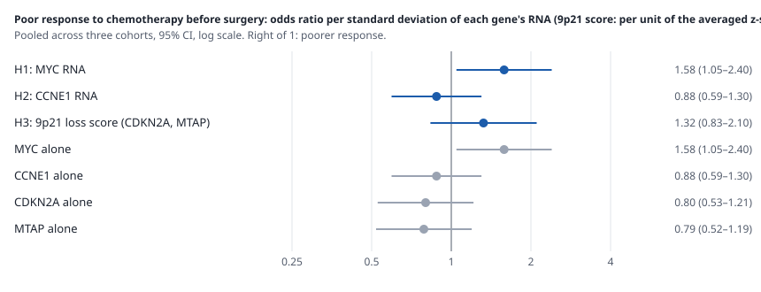

# Engine cycle 15: do tumours with MYC gain, CCNE1 gain or 9p21 loss respond worse to chemotherapy before surgery?

*Run November 26, 2026. The fifteenth cycle of the For John research engine. Pre-registration: `research_notes/Engine/cycle-15-chemo-response/PREREGISTRATION.md`, committed at commit `3fa7583` before any of these genes was read from these cohorts. Script: `tools/engine_cycle15_chemo_response.py`. Results: `data/engine/cycle15/results.csv`. Research only; not about any patient's treatment.*

## Summary

How much of the tumour chemotherapy kills before surgery is one of the strongest known signs of outcome in osteosarcoma (general knowledge). We asked whether three gene changes from earlier cycles go with a poor response. We used tumour RNA in three cohorts, 109 patients, 64 of whom had a poor response (less than 90% of the tumour killed).

- **MYC: supported by the pre-registered rule, modestly.**
  - Tumours with more MYC RNA were more likely to respond poorly: odds ratio 1.58 per standard deviation (95% CI 1.05–2.40, p = 0.03).
  - All three cohorts pointed the same way (1.32, 1.87 and 1.86), with no sign of disagreement between them (I² = 0%).
  - This is the engine's first "Supported" verdict in fifteen cycles.
- **CCNE1: refuted.** 0.88 (0.59–1.30); an odds ratio of 1.5 or more is ruled out.
- **9p21 loss: inconclusive.** 1.32 (0.83–2.10).
- **Predictions:** P43 (MYC supported, given 20%) was right. P44 (none supported) was wrong.

**Why this needs replication before anyone relies on it.**
- Three genes were tested and the plan fixed no correction for that. With a simple correction for three tests (p below 0.017), the MYC result would not pass.
- The interval's lower end sits just above 1.
- MYC RNA stands in for MYC gain. In the one cohort with copy-number calls (TARGET-OS), amplified tumours leaned the same way but too few to judge.
- A poor response is a sign of risk; it does not mean a different treatment would help.

**How to read the labels.** Every number here is **(our calculation)** from open data unless marked otherwise.

## What was tested

- **Cohorts:**
  - GSE21257 (Leiden; Huvos grade, 47 patients with a known grade);
  - GSE14827 ("good" or "poor" response, 27 patients);
  - TARGET-OS (Huvos stage from the open clinical spreadsheet, 35 patients).
- **Outcome:** poor response, meaning Huvos grade 1 or 2, or labelled "poor".
- **Measures:** RNA per standard deviation, within each cohort.
  - MYC (H1) and CCNE1 (H2).
  - A 9p21 loss score, the negative mean z-score of CDKN2A and MTAP (H3).
- **Effect:** odds ratio from a logistic model in each cohort, pooled by inverse-variance weighting.
- **Verdict rules, fixed in advance:**
  - Supported: the whole 95% interval is above 1.
  - Refuted: the upper end is below 1.5.
  - Inconclusive: anything else.

## Results

| Measure | GSE21257 (47; 29 poor) | GSE14827 (27; 16 poor) | TARGET-OS (35; 19 poor) | **Pooled (109; 64 poor)** | Verdict |
|---|---|---|---|---|---|
| **H1: MYC RNA** | 1.32 (0.72–2.42) | 1.87 (0.79–4.42) | 1.86 (0.87–3.96) | **1.58 (1.05–2.40)** | **Supported** |
| **H2: CCNE1 RNA** | 1.03 (0.56–1.87) | 0.76 (0.34–1.67) | 0.81 (0.41–1.60) | **0.88 (0.59–1.30)** | **Refuted** |
| **H3: 9p21 loss score** | 1.74 (0.84–3.60) | 2.10 (0.76–5.83) | 0.78 (0.37–1.64) | **1.32 (0.83–2.10)** | **Inconclusive** |

- **Random effects** give the same MYC result (1.58, 1.05–2.40). For the 9p21 score they give 1.35 (0.74–2.47).
- **Huvos grade 1 to 4 as an ordered outcome in GSE21257** (Spearman correlation, where a negative value means poorer response with more of the measure):
  - MYC −0.06;
  - CCNE1 −0.01;
  - 9p21 loss score −0.18.
  - All are weak, so the MYC result rests mainly on the two smaller cohorts.
- **TARGET-OS copy-number calls** (descriptive):
  - MYC-amplified tumours responded poorly in 7 of 10, against 10 of 22 without amplification (Fisher's p = 0.27).
  - CCNE1 amplification: 2 of 4 against 15 of 28.
  - CDKN2A deep deletion: 2 of 5 against 15 of 27.

## What this means

- **MYC is worth a proper replication.** The direction held in every cohort, and MYC gain is one of the more common changes in osteosarcoma. This project's copy-number report and cycle 7 found it in a meaningful minority of tumours, and prediction P2 already asks whether MYC gain marks poorer outcomes on kinase pills.
- **The right next test:**
  - MYC copy number, not RNA, against histologic response in a larger cohort with both measured. Hospital sequencing cohorts record copy number but, on cBioPortal, not response.
  - So it needs a centre's own records, or a public cohort not yet found.
  - It is added to the Research Queue.
- **CCNE1 gain does not look like a marker of poor chemotherapy response.** That separates the CCNE1-drug question (cycles 6, 7 and 10) from the question of who responds to standard treatment.
- **For families:** nothing here changes care. Histologic response is already measured after surgery and used by care teams. A gene test is not a substitute for it.

## Limits

- 109 patients in three small cohorts, with different platforms and response records.
- RNA stands in for copy-number change.
- Three tests, uncorrected by the plan.
- No built-in check was possible, because no RNA marker of response is established well enough.
- Response was recorded after different chemotherapy protocols.

## Files and reproduction

- Run the downloads of engine cycle 1, including the GPL570 annotation now saved there, and the TARGET-OS stage of `tools/survival_analysis.py`.
- Then `python3 tools/engine_cycle15_chemo_response.py`.
- Outputs: `data/engine/cycle15/results.csv`, `data/engine/cycle15/summary.json` and `docs/figures/engine15_response.svg`.

**Data sources and credit.**
- NCBI GEO: GSE21257 (Leiden University Medical Center) and GSE14827 (PubMed 20159990).
- TARGET-OS: NCI TARGET, via the Genomic Data Commons.

## Change log

- 2026-11-26: cycle run and reported. H1 supported, H2 refuted and H3 inconclusive under the pre-registered rules. P43 right, P44 wrong. No deviations.
