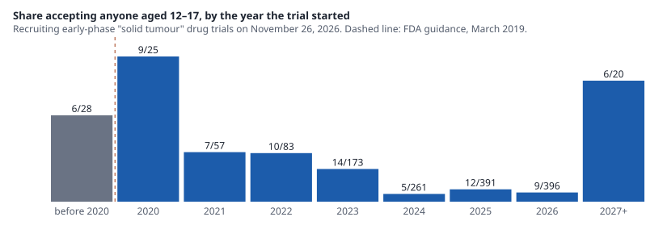

# Engine cycle 16: since the FDA's 2019 guidance, are new early-phase cancer trials more likely to take teenagers?

*Run November 26, 2026. The sixteenth cycle of the For John research engine. Pre-registration: `research_notes/Engine/cycle-16-fda-guidance/PREREGISTRATION.md`, committed at commit `3a71706` before any trial start date was read. Script: `tools/engine_cycle16_fda_guidance.py`. Results: `data/engine/cycle16/`. Uses the ClinicalTrials.gov records saved by engine cycle 12 on November 26, 2026.*

## Summary

In 2019 the US Food and Drug Administration recommended including 12- to 17-year-olds in adult cancer trials relevant to them: in first-in-human and dose-finding trials once some adult dosing data exist, and in trials that measure whether a drug works at the same time as adults. We asked whether recruiting or soon-to-recruit early-phase "solid tumour" drug trials that started in 2020 or later accept teenagers more often than those that started earlier.

- **No sign of an increase.**
  - Trials started in 2020 or later: 72 of 1,406 accept teenagers (5.1%).
  - Trials started earlier: 6 of 28 (21%).
  - Odds ratio 0.20 (95% CI 0.08–0.50). By the pre-registered rule, the increase is **refuted**.
- **But this comparison is weak, as the plan warned.**
  - Every trial here was recruiting or about to recruit in November 2026 (all 28 older ones were recruiting), so the "before" group is the 28 unusual trials that have run for six years or more. Many are academic or children's studies that add groups over time.
  - The comparison shows the guidance has not made today's new trials more open. It cannot show what trials were like before 2019.
- **The clearest number.** Of 1,083 company-led early-phase solid-tumour trials that started in 2020 or later and are recruiting or about to, 26 (2.4%) accept 12- to 17-year-olds. Prediction P46 (under 5%) was right.
- **Predictions:** P45 (an increase) was wrong; P46 was right.

**How to read the labels.** Every number here is **(our calculation)** from **(registry)** records.

## Results

| Group | Started before 2020 | Started 2020 or later | Odds ratio (95% CI) |
|---|---|---|---|
| **All 1,434 trials (H1)** | **6 of 28 (21%)** | **72 of 1,406 (5.1%)** | **0.20 (0.08–0.50)** |
| Company-led | 3 of 14 (21%) | 26 of 1,083 (2.4%) | 0.09 (0.02–0.34) |
| Led by universities, hospitals or others | 3 of 14 (21%) | 46 of 323 (14%) | 0.61 (0.16–2.27) |
| Leaving out trials that start under age 12 | 3 of 25 (12%) | 35 of 1,368 (2.6%) | 0.19 (0.06–0.67) |

- **All 1,434 trials have a start date** (actual or expected).
- **By start year**, the share accepting teenagers falls from 36% of 25 trials started in 2020 to 2–3% of the several hundred started in each of 2024, 2025 and 2026. The 20 trials not expected to start until 2027 or later are an exception (6 accept teenagers), too few to read.
- **The same bias likely drives the year-by-year pattern.** The older a still-recruiting trial is, the more likely it is a long-running study that broadened over time.

## What this means

- **Today's new-drug trials still almost all start at 18.** The guidance has been out for seven years. Among company-led early-phase trials that started since 2020, about 1 in 40 accepts a teenager.
- **The before-and-after question is not settled by this design.** The fair test compares all trials registered in each period, including those now closed. The registry allows that search, so it is the next cycle.
- **For the brief:** the 2.4% figure is a clean description of current trials and could be added to the brief, with its date.

## Limits

- Only trials recruiting on one day.
- The start date is the registry's actual or anticipated date.
- "Accepts teenagers" reads only the age fields.
- Set B mixes adult and children's trials. The last row of the table removes trials starting under 12 and finds the same pattern.

## Files and reproduction

- Run `python3 tools/engine_cycle12_teen_access.py fetch` (cycle 12) first.
- Then `python3 tools/engine_cycle16_fda_guidance.py`.
- Outputs: `data/engine/cycle16/results.json`, `data/engine/cycle16/by_year.csv` and `docs/figures/engine16_years.svg`.
- A re-run on a later day uses a different snapshot.

**Data source.** ClinicalTrials.gov API v2 (US National Library of Medicine). FDA, *Considerations for the Inclusion of Adolescent Patients in Adult Oncology Clinical Trials*, guidance for industry, March 2019.

## Change log

- 2026-11-26: cycle run and reported. H1 refuted by the pre-registered rule, with the survivorship bias stated in the plan. P45 wrong, P46 right. No deviations.
