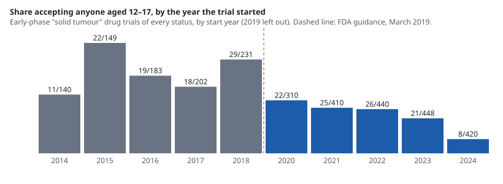

# Engine cycle 17: before and after the FDA's 2019 guidance, across all trials

*Run November 26, 2026. The seventeenth cycle of the For John research engine. Pre-registration: `research_notes/Engine/cycle-17-fda-guidance-all-trials/PREREGISTRATION.md`, committed at commit `c2841de` before the registry was searched. Script: `tools/engine_cycle17_fda_all_trials.py`. Results: `data/engine/cycle17/`. Based on ClinicalTrials.gov records read on November 26, 2026.*

## Summary

In March 2019 the US Food and Drug Administration recommended including 12- to 17-year-olds in adult cancer trials relevant to them. Cycle 16 compared trials recruiting today and could not judge the period before the guidance fairly. This cycle counts every early-phase "solid tumour" drug trial that started in 2014–2018 or 2020–2024, whatever its status now: 2,933 trials.

- **The share accepting teenagers fell; it did not rise.**
  - 2014–2018: 99 of 905 trials (10.9%).
  - 2020–2024: 102 of 2,028 (5.0%).
  - Odds ratio 0.43 (95% CI 0.32–0.58). By the pre-registered rule, an increase is **refuted**.
- **The fall is not only a change in who runs trials.** Company-led trials rose from 66% to 79% of the total, and companies admit teenagers least. But the share fell within each group:
  - company-led: 4.8% to 2.9%;
  - led by universities, hospitals or others: 23% to 13%;
  - trials built for adults (minimum age 12 or over, or none stated): 4.6% to 2.9%, odds ratio 0.61 (0.40–0.93).
- **Company-led adult trials barely changed:** 2.6% to 2.0% (0.79, 0.42–1.47). The guidance has not visibly opened them.
- **Predictions:** P47 (an increase) was wrong. P48 (under 5% of company-led trials in 2020–2024 accept teenagers: 2.9%) was right.

**How to read the labels.** Every number here is **(our calculation)** from **(registry)** records.

## What was counted

- **Search:** the registry's condition search for "solid tumor", interventional trials with a start date in 2014–2018 (before) or 2020–2024 (after), every status. 2019 was left out.
  - 144 withdrawn records in the raw search (before the filters below) were excluded.
- **Same filters as cycle 12's Set B:**
  - a condition reading "solid tumor", "solid tumour" or "solid neoplasm";
  - phase 1, 1/2, early phase 1 or 2 (15 phase 2/3 trials also entered; see Deviations);
  - a drug, biological or genetic intervention.
- **Accepts teenagers:** the minimum age is 17 or younger (or none is given) and any maximum age is 12 or older.

## Results

| Group | 2014–2018 | 2020–2024 | Odds ratio (95% CI) |
|---|---|---|---|
| **All trials (H1)** | **99 of 905 (10.9%)** | **102 of 2,028 (5.0%)** | **0.43 (0.32–0.58)** |
| Company-led | 29 of 600 (4.8%) | 46 of 1,593 (2.9%) | 0.59 (0.36–0.94) |
| Led by universities, hospitals or others | 70 of 305 (23%) | 56 of 435 (13%) | 0.50 (0.34–0.73) |
| Trials built for adults (minimum age 12 or over, or none stated) | 39 of 845 (4.6%) | 57 of 1,982 (2.9%) | 0.61 (0.40–0.93) |
| Company-led trials built for adults | 15 of 586 (2.6%) | 32 of 1,578 (2.0%) | 0.79 (0.42–1.47) |

**By start year,** the share accepting teenagers was:
- 8% to 15% in each year from 2014 to 2018;
- 7% in 2020 and 5% to 6% in each of 2021–2023;
- 2% in 2024 (8 of 420).

The full table is in `data/engine/cycle17/by_year.csv`.

## What this means

- **Seven years on, the guidance has not shown up in the registry.**
  - Early-phase solid-tumour trials take teenagers half as often as before it.
  - Trials built for adults, the kind the guidance addressed, take them less often too.
  - Company-led adult trials stayed at about 2%.
- **Part of the fall reflects a changing mix:** more company-led trials and relatively fewer academic and children's trials, both of which admit teenagers more often. But the fall holds within each group, so the mix does not explain it away.
- **For the brief:** this supports its request with a registry-wide trend, not only the 34 trials it counted.

## Limits and checks

- **The registry shows each trial's current age limits.** If older trials were later amended to admit teenagers, the "before" share may be inflated.
- **Many 2020–2024 trials are still running** and could still be amended to include teenagers. Then the "after" share would rise.
- **A condition labelled "solid tumor" is a registry convention** that may have changed over time.
- **One search on one day, one registry.**

## Deviations

- **Phase filter.** As in cycle 12, the code kept any trial with an early phase among its phases, so 15 phase 2/3 trials entered. Without them the odds ratio is 0.41; no conclusion changes.

## Files and reproduction

- `python3 tools/engine_cycle17_fda_all_trials.py fetch` searches ClinicalTrials.gov. Raw records go to `data/engine/cycle17/raw/`, which is not in git because they include staff contact details.
- `python3 tools/engine_cycle17_fda_all_trials.py` builds the outputs:
  - `data/engine/cycle17/trials.csv`, `results.json` and `by_year.csv`;
  - `docs/figures/engine17_years.svg`.

**Data source.** ClinicalTrials.gov API v2 (US National Library of Medicine). FDA, *Considerations for the Inclusion of Adolescent Patients in Adult Oncology Clinical Trials*, guidance for industry, March 2019.

## Change log

- 2026-11-26: after an independent check, the phase 2/3 inclusion declared as a deviation, and three descriptions made exact (adult-type trials include those with no stated minimum age; the 144 withdrawn records; "company-led" rather than "first-in-human").
- 2026-11-26: cycle run and reported. H1 refuted: the share fell. P47 wrong, P48 right. No deviations.
