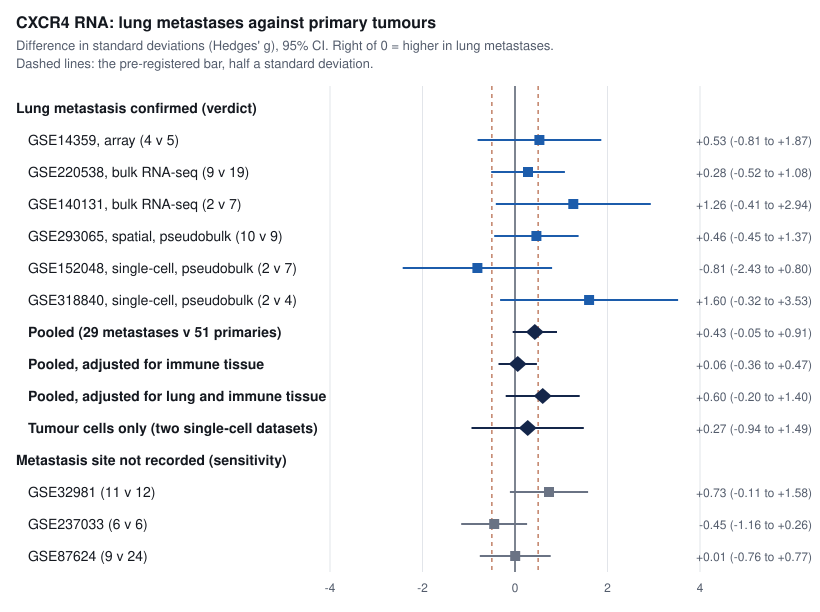
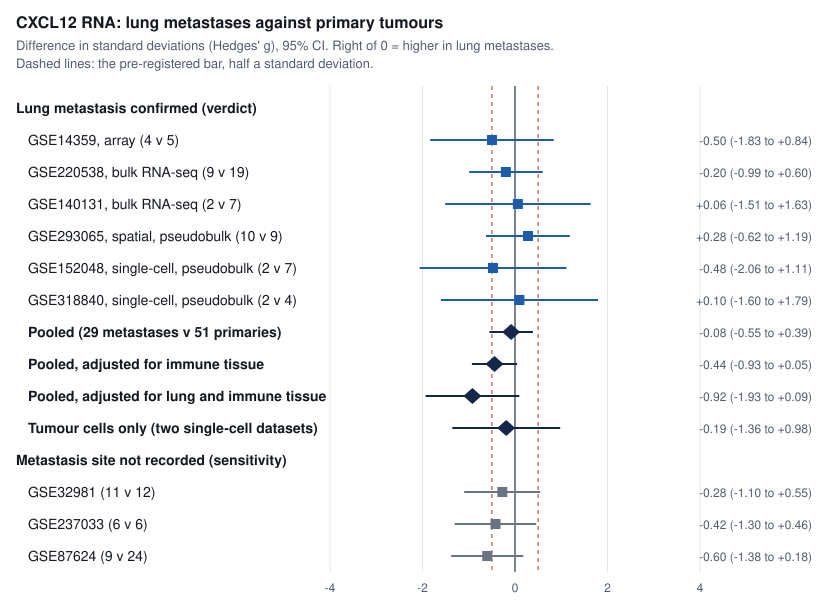

# Engine cycle 2: do lung metastases carry more CXCR4?

*Run November 24, 2026. The second cycle of the For John research engine. Pre-registration: `research_notes/Engine/cycle-02-cxcr4/PREREGISTRATION.md`, committed at 18:53 UTC (commit `5fd3cad`) before any dataset was searched for, with the dataset choices and two predictions committed at 18:59 UTC (`b324482`) before any expression value was read. Script: `tools/engine_cycle02_cxcr4.py`. Results: `data/engine/cycle02/results.csv`.*

## Summary

Lead 14 proposes blocking CXCR4, a receptor that mouse studies say guides osteosarcoma cells to the lung, where its signal CXCL12 is plentiful. If that happens in patients, tumour that has reached the lung should carry more CXCR4 than tumour in the bone. We compared 29 lung metastases with 51 primary tumours across six public datasets. CXCR4 RNA leaned higher in the lung metastases, by 0.43 standard deviations, but the range of uncertainty runs from just below zero to 0.91, so by the rules written down in advance the verdict is **inconclusive**. The lean also looks like it comes from immune cells, not tumour cells: lung metastases held more immune cells, immune cells make a lot of CXCR4, and once immune content was accounted for the difference was 0.06. In four patients with both a primary tumour and a lung metastasis, there was no clear difference. CXCL12 was not lower in lung metastases (−0.08), also **inconclusive** by the rules. Lead 14 gains no support from this test and is not promoted.

**How to read the labels.** Every number here is **(our calculation)** from open data unless marked otherwise.

## What was tested

- **H1:** CXCR4 RNA is higher in osteosarcoma lung metastases than in primary tumours.
- **H2:** CXCL12 RNA is lower in lung metastases than in primary tumours.
- **Measure:** the difference between the two groups in standard deviations (Hedges' g), one value per patient or lesion, pooled across datasets. Half a standard deviation was set in advance as the smallest difference that would matter.
- **The known trap, stated in advance:** a piece of lung metastasis contains lung tissue and immune cells as well as tumour. So the plan also adjusted for a lung score (three genes made by lung air-sac cells) and an immune score (PTPRC, found on all white blood cells), and looked at tumour cells alone in single-cell data.

**Datasets with lung metastases confirmed per sample (used for the verdicts):**

| Dataset | Type | Lung metastases | Primary tumours |
|---|---|---|---|
| GSE14359 | Microarray | 4 patients | 5 patients |
| GSE220538 | Bulk RNA sequencing | 9 patients | 19 patients |
| GSE140131 | Bulk RNA sequencing | 2 patients | 7 patients |
| GSE293065 | Spatial transcriptomics, summed per section | 10 lesions | 9 tumours |
| GSE152048 | Single-cell RNA sequencing, summed per lesion | 2 lesions | 7 lesions |
| GSE318840 | Single-cell RNA sequencing, summed per tumour | 2 patients | 4 patients |
| **Total** | | **29** | **51** |

Three more datasets label samples "metastasis" without saying where in the body. They are shown separately and do not count towards the verdicts. The full list of datasets found, used and excluded, with reasons, is in the pre-registration.

## Results

**CXCR4, lung metastases minus primary tumours:**

| Analysis | Lung metastases v primaries | Difference in SD (95% CI) |
|---|---|---|
| GSE14359 | 4 v 5 | +0.53 (−0.81 to +1.87) |
| GSE220538 | 9 v 19 | +0.28 (−0.52 to +1.08) |
| GSE140131 | 2 v 7 | +1.26 (−0.41 to +2.94) |
| GSE293065 | 10 v 9 | +0.46 (−0.45 to +1.37) |
| GSE152048 | 2 v 7 | −0.81 (−2.43 to +0.80) |
| GSE318840 | 2 v 4 | +1.60 (−0.32 to +3.53) |
| **Pooled** | **29 v 51** | **+0.43 (−0.05 to +0.91), p = 0.08** |
| Pooled, adjusted for immune score | 29 v 51 | +0.06 (−0.36 to +0.47) |
| Pooled, adjusted for lung and immune scores | 29 v 51 | +0.60 (−0.20 to +1.40) |
| Tumour cells only, two single-cell datasets | 4 v 11 | +0.27 (−0.94 to +1.49) |
| Four matched patients (GSE220538), paired | 4 pairs | +0.05 (−1.06 to +1.17) |

- **Verdict for H1: Inconclusive.** "Supported" needed a lower bound above 0 and a difference of at least 0.5; the lower bound is −0.05 and the estimate 0.43. "Refuted" needed the upper bound below 0.5; it is 0.91. The six datasets agree with each other (I² = 0%).
- **The lean follows immune cells.** The immune score was higher in lung metastases (+0.68, 0.19 to 1.17). Adjusting for it took the CXCR4 difference from 0.43 to 0.06.
- **Adjusting for lung tissue is not reliable here.** The lung score was 3.2 standard deviations higher in metastases, as it should be, which shows the samples are labelled correctly. But a score that separates the groups that well cannot be told apart from the group itself, so the lung-adjusted figures swing widely between datasets and should not be leaned on.
- **Tumour cells alone gave no clear answer.** With only four lung metastases in the single-cell data, the range covers everything from a large decrease to a large increase. Between 2% and 15% of tumour-classed cells in primary tumours carried any CXCR4 RNA, against 3%, 10%, 17% and 34% in the four lung metastases.

**CXCL12:**

| Analysis | Lung metastases v primaries | Difference in SD (95% CI) |
|---|---|---|
| **Pooled, six datasets** | **29 v 51** | **−0.08 (−0.55 to +0.39), p = 0.73** |
| Pooled, adjusted for immune score | 29 v 51 | −0.44 (−0.93 to +0.05) |
| Tumour cells only, two single-cell datasets | 4 v 11 | −0.19 (−1.36 to +0.98) |
| Four matched patients, paired | 4 pairs | +0.27 (−1.07 to +1.60) |

- **Verdict for H2: Inconclusive.** No decrease was seen. "Refuted" needed the lower bound above −0.5; it is −0.55.

## Checks

- **Datasets where the metastasis site is not recorded** (not used for the verdicts). CXCR4: GSE32981 +0.73 (−0.11 to +1.58), GSE237033 paired −0.45 (−1.16 to +0.26), GSE87624 +0.01 (−0.76 to +0.77). All nine datasets pooled: CXCR4 +0.21 (−0.11 to +0.54), CXCL12 −0.26 (−0.59 to +0.08). Adding them weakens the CXCR4 lean.
- **Arrays and bulk sequencing only**, leaving out the summed single-cell and spatial data: CXCR4 +0.48 (−0.16 to +1.11), CXCL12 −0.22 (−0.85 to +0.40). The same picture.
- **The second receptor, ACKR3 (CXCR7):** no difference, −0.09 (−0.57 to +0.39).
- **Random-effects pooling** gave the same figures as fixed-effect for CXCR4 and CXCL12.

**Exploratory, not pre-registered.** Two further looks, made after the results were seen, to understand the immune finding. They generate ideas and prove nothing.

- In the single-cell data, immune cells held 24%, 45%, 53% and 67% of all CXCR4 RNA in the four lung metastases, and a median of 21% in the eleven primary tumours (range 5% to 86%).
- Within each group, CXCR4 rose with the immune marker in five of six datasets (correlations of 0.16 to 0.82, and −0.39 in the smallest dataset).

## What this means

- **Lead 14 gains no support and stays at the bottom of the list.** Whole-tissue CXCR4 leans higher in lung metastases, but the lean is what more immune cells would produce, and the matched patients show nothing.
- **It is not ruled out either.** With 29 lung metastases, a real difference of half a standard deviation could be missed. RNA is not protein: an earlier study that stained tissue found CXCR4 protein in 33% of primary tumours and 67% of matched lung metastases (paper, abstract only; PMID 16528367), and nothing here contradicts it.
- **The deciding experiment is staining, not more RNA.** CXCR4 protein scored on tumour cells only, in matched primary tumours and lung metastases from the same patients, would answer what whole-tissue RNA cannot. That needs a pathology partner and is added to the Research Queue.
- **A caution for anyone using CXCR4 RNA in osteosarcoma.** Whole-tumour CXCR4 partly measures how many immune cells are in the sample. Studies linking CXCR4 RNA to outcome, in either direction, should account for that.
- **Predictions P16 and P17** are unresolved by their own rules and recorded as such.

## Limits

- Small numbers. About 64 tumours per group, or 34 matched pairs, would be needed to detect half a standard deviation reliably. Three datasets have only two lung metastases each.
- Lung metastases are usually removed after chemotherapy and later in the illness than primary biopsies. Differences in treatment and timing cannot be separated from differences in site.
- Six datasets on four technologies. Standardising within each dataset helps but does not remove this.
- The tumour-cell rule for single-cell data cannot tell tumour cells from normal bone-forming cells or fibroblasts, and stray RNA floating in a single-cell sample can make a tumour cell look like a lung cell and be discarded.
- The spatial dataset was added as a data type after the plan was written (recorded as a deviation before its values were read).
- This concerns RNA in tissue. It says nothing about CXCR4 protein on the cell surface or about the effect of blocking the receptor.

## Files and reproduction

- `tools/engine_cycle02_fetch.sh` downloads and unpacks the GEO files (about 1.5 GB) into `data/engine/cycle02/raw/` (not stored in git). `tools/engine_cycle02_cxcr4.py` runs the analysis in about a minute.
- Outputs: `data/engine/cycle02/results.csv`, `data/engine/cycle02/summary.json`, `data/engine/cycle02/sample_values.csv` (the value used for every patient or lesion), `docs/figures/engine02_cxcr4_forest.svg`, `docs/figures/engine02_cxcl12_forest.svg`.

## Change log

- 2026-11-27: after an independent check, "no difference" in four paired patients changed to "no clear difference".
- 2026-11-24: cycle run and reported. Both verdicts inconclusive under the pre-registered rules. The gene-name lookup was widened to older names for ACKR3 (CXCR7, CMKOR1) after the first run so that two sensitivity datasets were not dropped for that gene; no verdict depends on it.
