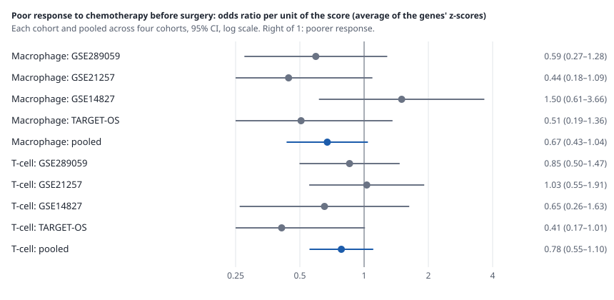

# Engine cycle 20: do tumours with more macrophage or T-cell signal respond better to chemotherapy before surgery?

*Run November 27, 2026. The twentieth cycle of the For John research engine. Pre-registration: `research_notes/Engine/cycle-20-immune-response/PREREGISTRATION.md`, committed at commit `822196e` before these genes were compared with response. Script: `tools/engine_cycle20_immune_response.py`. Results: `data/engine/cycle20/`. Research only; not about any patient's treatment.*

## Summary

We pooled four cohorts with tumour RNA taken before treatment and a recorded response to chemotherapy before surgery: 171 patients, 94 with a poor response. One cohort is new to this project: 62 patients from the Italian ISG/OS2 trial (GEO GSE289059).

- **Macrophage score (CD163, CD14, CD68): inconclusive, leaning towards better response.**
  - Odds ratio for poor response 0.67 per unit of the score (the average of the genes' z-scores; 95% CI 0.43–1.04). Random effects: 0.67 (0.40–1.14), I² 31%.
  - Three of the four cohorts leaned the same way, including the new one (0.59, 0.28–1.28; 0.54 after adjusting for P-glycoprotein status).
- **T-cell score (CD3E, CD8A): inconclusive,** 0.78 (0.55–1.10).
- **Exploratory flag, not a result:** CD68 alone pooled to 0.61 (0.43–0.87), one of five single genes, uncorrected.
- **Predictions:** P54 and P55 were wrong.
- **What it means:** the macrophage lean is consistent with cycle 14's weak survival signal but does not establish it. Neither score is a usable marker of response.
- **Why the MYC result from cycle 15 could not be checked here:** the new cohort's gene panel does not include MYC.

**How to read the labels.** Every number here is **(our calculation)** from open data.

## Results

| Cohort | Patients (poor response) | Macrophage score | T-cell score |
|---|---|---|---|
| GSE289059 (ISG/OS2; new) | 62 (30) | 0.59 (0.28–1.28) | 0.86 (0.50–1.47) |
| GSE21257 (Leiden) | 47 (29) | 0.44 (0.18–1.09) | 1.03 (0.55–1.91) |
| GSE14827 | 27 (16) | 1.50 (0.61–3.66) | 0.65 (0.26–1.63) |
| TARGET-OS | 35 (19) | 0.51 (0.19–1.36) | 0.41 (0.17–1.01) |
| **Pooled** | **171 (94)** | **0.67 (0.43–1.04)** | **0.78 (0.55–1.10)** |

**Verdict rules, fixed in advance:**
- Supported: the whole 95% interval below 1.
- Refuted: the lower end above 0.67.
- Inconclusive: anything else.

Single-gene results are in `data/engine/cycle20/results.csv`.

## Limits

- Bulk RNA as a stand-in for immune cells.
- Four small cohorts on four platforms.
- Two of the four cohorts (GSE21257, TARGET-OS) had these genes read for cycle 14, against survival; GSE289059 and GSE14827 had not. None had been compared with response.
- The GSE289059 file was downloaded to read its sample descriptions before the plan was committed; the order of reading rests on our account.

## Deviations

- **Scale of the effect.** The plan defined the effect per standard deviation, but the script used the average of the genes' z-scores without rescaling it. On a true per-SD scale the pooled odds ratios are 0.72 (0.52–1.01) for the macrophage score and 0.79 (0.57–1.10) for the T-cell score. Both verdicts are unchanged (inconclusive).

## Files and reproduction

- `python3 tools/engine_cycle20_immune_response.py fetch`, then without `fetch`. This needs engine cycle 1's downloads and the TARGET-OS files.
- **Data:** NCBI GEO GSE289059 (ISG/OS2 trial; PubMed 40711479), GSE21257, GSE14827; TARGET-OS via the Genomic Data Commons.

## Change log

- 2026-11-28: after an independent check, the per-standard-deviation results added and the scale difference declared as a deviation.
- 2026-11-27: after an independent check, T-cell interval corrected (0.55, not 0.56), random effects, the CD68 flag and the figure added, the scale of the score stated, and which cohorts were read before made exact.
- 2026-11-27: cycle run and reported. H1 and H2 inconclusive; P54 and P55 wrong.
