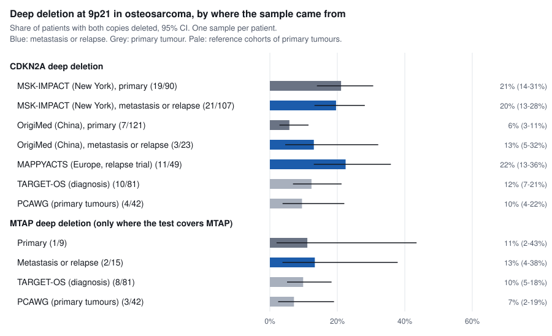

# Engine cycle 3: is 9p21 deletion more common at relapse?

*Run November 24, 2026. The third cycle of the For John research engine. Pre-registration: `research_notes/Engine/cycle-03-9p21/PREREGISTRATION.md`, committed at 20:00 UTC (commit `35e2b8e`) before any study was listed, with the study choices and a prediction committed at 20:03 UTC (`e0348e4`) before any copy-number call was read. Script: `tools/engine_cycle03_9p21.py`. Results: `data/engine/cycle03/results.csv`.*

## Summary

Some tumours delete both copies of a stretch of chromosome 9 called 9p21, which holds the genes CDKN2A and MTAP. Tumours that have lost MTAP are the target of a new class of drugs (PRMT5 inhibitors) now in adult trials. We asked whether this deletion is more common in osteosarcoma that has spread or come back than in primary tumours, using two hospital sequencing cohorts with 341 patients. It was not clearly more common: the pooled odds ratio was 1.10, with a range of uncertainty from 0.59 to 2.06, so the pre-registered verdict is **inconclusive**. Two things came out that are useful anyway. First, about one in five relapsed or metastatic osteosarcomas carries the CDKN2A deletion (35 of 179, 20%). Second, in 30 patients tested twice, the primary tumour and the later sample agreed in 28: the result usually matched, but few of these patients had the deletion (7), and 2 of those 7 differed between samples, so a test of the primary tumour is a guide, not a guarantee. The gap is MTAP itself. Only 24 of the 341 patients had a test that looks at MTAP, so how many relapsed patients could enter an MTAP-selected trial is still an estimate, about one in seven.

**How to read the labels.** Every number here is **(our calculation)** from open data unless marked otherwise.

## What was tested

- **H1:** deep (two-copy) deletion of CDKN2A is more frequent in osteosarcoma samples from a metastasis or relapse than in samples from a primary tumour.
- **Descriptive aim:** the share of metastatic or relapsed osteosarcomas with deep deletion of MTAP.
- **Why CDKN2A stands in for MTAP:** the two genes sit side by side and are usually lost together, and every gene-panel test covers CDKN2A while few cover MTAP.
- **Cohorts,** from the public cBioPortal database, each patient counted once:

| Cohort | Test | Patients in the metastasis or relapse group | Patients in the primary group |
|---|---|---|---|
| MSK-IMPACT, New York | Hospital gene panel | 107 (101 metastases, 6 local recurrences) | 90 |
| OrigiMed, China | Commercial gene panel | 23 (14 metastases, 9 recurrences) | 121 |
| **Total** | | **130** | **211** |

A patient with any metastasis or relapse sample was placed in that group; patients with only primary samples formed the other. A European trial for relapsed childhood cancers (MAPPYACTS, 49 osteosarcoma patients with copy-number results) records no sample type, so it adds to the relapse-stage frequency but not to the comparison.

## Results

**CDKN2A deep deletion, metastasis or relapse against primary:**

| Cohort | Metastasis or relapse | Primary | Odds ratio (95% CI) |
|---|---|---|---|
| MSK-IMPACT | 21 of 107 (19.6%) | 19 of 90 (21.1%) | 0.91 (0.46–1.83) |
| OrigiMed | 3 of 23 (13.0%) | 7 of 121 (5.8%) | 2.44 (0.58–10.24) |
| **Pooled** | | | **1.10 (0.59–2.06), p = 0.76** |
| Pooled, adjusted for tumour purity | | | 1.16 (0.61–2.22) |

- **Verdict for H1: Inconclusive.** "Supported" needed a lower bound above 1.0 and an odds ratio of at least 1.5. "Refuted" needed the upper bound below 1.5; it is 2.06. The larger cohort shows no difference at all, and the smaller one leans higher on three patients.
- **Do not read the raw totals.** Added together, the groups show 18.5% against 12.3%, but that gap comes from mixing two cohorts with different rates and different shares of relapse samples. The comparison that counts is within each cohort, as planned.
- **Not underpowered by the rule set in advance** (the smaller group has 130 patients, above the 100 required), but still too small to settle a modest difference. About 500 patients per group would be needed to detect an odds ratio of 1.5.

**How common the deletion is at relapse** (descriptive, three cohorts):

| Gene | Metastatic or relapsed patients with deep deletion | Share (95% CI) |
|---|---|---|
| CDKN2A | 35 of 179 (21 of 107 MSK-IMPACT, 3 of 23 OrigiMed, 11 of 49 MAPPYACTS) | 19.6% (14.4–26.0%) |
| MTAP, measured directly | 2 of 15 (MSK-IMPACT patients on the newest test only) | 13% (4–38%) |

- **MTAP is hardly measured.** OrigiMed and MAPPYACTS do not report MTAP, and at Memorial Sloan Kettering only the newest version of the test covers it: 24 patients, 15 of them in the relapse group.
- **How often MTAP goes with CDKN2A.** Where both were measured, MTAP was deleted in 14 of 19 tumours with CDKN2A deletion (74%): 3 of 5 at Memorial Sloan Kettering, 8 of 10 in TARGET-OS and 3 of 4 in the PCAWG whole-genome set. No tumour had lost MTAP without CDKN2A.
- **A rough estimate, not a measurement:** 20% with CDKN2A deletion, times 74% of those also missing MTAP, gives about 14% of relapsed patients, or one in seven, with a plausible range of 7% to 23%.

## Checks

- **Same patient, two samples.** Thirty Memorial Sloan Kettering patients had both a primary tumour and a later metastasis or recurrence tested. Twenty-three had no deletion in either, five had it in both, one gained it and one lost it. Agreement was 28 of 30.
- **Tumour purity** did not differ between groups (median 50% against 50% at Memorial Sloan Kettering, 65% against 60% at OrigiMed), and adjusting for it changed nothing.
- **Is CDKN2A special?** Deep deletions in general were not called more often in relapse samples. At Memorial Sloan Kettering 40% of relapse-group patients had any deep deletion against 54% of the primary group. Among the other genes deleted in more than 3% of patients, none differed between groups: RB1 0.73 (0.33–1.65), TP53 0.64 (0.26–1.54), PTEN 0.88 (0.29–2.66).
- **Distant metastases only:** 1.08 (0.57–2.08). **Lung metastases only** (Memorial Sloan Kettering): 11 of 66 against 19 of 90, 0.75 (0.33–1.70). **Local recurrences only:** 2 of 15, too few to say.
- **Counting every sample** instead of one per patient: 1.12 (0.64–1.95).
- **CDKN2B,** the neighbouring gene: 1.14 (0.60–2.16), the same as CDKN2A.
- **Primary tumours in two research cohorts, for reference:** CDKN2A deleted in 10 of 81 in TARGET-OS (12.3%) and 4 of 42 in PCAWG (9.5%). This project's own analysis of TARGET-OS, with a different calling method, found 11 of 81 (`reports/Copy-number changes and the kinase-pill biomarker.md`).

## What this means

- **The idea that relapse enriches for 9p21 deletion is not supported, and not ruled out.** The best single comparison, within one hospital, shows the same rate in both groups.
- **About one in five relapsed osteosarcomas has lost CDKN2A,** in three cohorts from three continents. That is a real group of patients.
- **The deletion often stays, but not always.** Primary and later samples usually agreed, mostly because neither had the deletion; of 7 patients who ever had it, 2 differed. A test at diagnosis is a guide, and whether a trial accepts an earlier report is up to the trial.
- **The number a trial needs is missing.** Whether about one in seven relapsed patients truly lack MTAP has been measured in 15 people. Closing that gap needs either the newer gene panel on stored samples or a simple MTAP stain on tissue, which is a routine pathology test (general knowledge).
- **Not a lead yet.** No one has shown that osteosarcoma cells without MTAP respond to PRMT5 inhibitors. That is a laboratory question and the next step is to look for it, not to assume it.
- **Prediction P18** is unresolved by its own rule and recorded as such.

**Added to the Research Queue:** which MTAP-selected drug trials accept osteosarcoma and at what ages (a registry search this project can do); and MTAP staining of stored relapse samples (needs a pathology partner).

## Limits

- Hospital sequencing is offered mostly to patients with advanced disease. The "primary" group here is not a sample of all patients at diagnosis; many of those patients already had, or later developed, metastases.
- Deep-deletion calls from gene panels are less certain than from whole genomes, and each cohort uses its own calling method. A deletion in a sample with little tumour in it can be missed.
- The two cohorts disagree in direction (I² = 32%), and the OrigiMed relapse group has 23 patients.
- MAPPYACTS reports only a selected list of altered genes and no sample type; it is used for the frequency only.
- The MTAP estimate multiplies two uncertain numbers and is not a measurement.
- Losing the gene is not the same as losing the protein, and neither shows that a drug would work.

## Files and reproduction

- `python3 tools/engine_cycle03_9p21.py fetch` downloads the data from the public cBioPortal API into `data/engine/cycle03/raw/` (a few megabytes, not stored in git). `python3 tools/engine_cycle03_9p21.py` runs the analysis in seconds.
- Outputs: `data/engine/cycle03/results.csv`, `data/engine/cycle03/summary.json`, `docs/figures/engine03_9p21.svg`.
- Studies: `msk_impact_50k_2026`, `pan_origimed_2020`, `pancan_mappyacts_2022`, `os_target_gdc`, `pancan_pcawg_2020`, as on cBioPortal on November 24, 2026.

**Data sources and credit.** Patient data were read from cBioPortal (Cerami et al., Cancer Discovery 2012; Gao et al., Science Signaling 2013) and come from the original studies: MSK-IMPACT 50K Clinical Sequencing Cohort (Memorial Sloan Kettering), China Pan-cancer (OrigiMed, Nature 2022), MAPPYACTS (Gustave Roussy, Cancer Discovery 2022), TARGET-OS (NCI TARGET, via the GDC) and the Pan-Cancer Analysis of Whole Genomes (Nature 2020). Only counts and summary statistics are published here; the per-patient table stays with the local download.

## Change log

- 2026-11-27: after an independent check, the claim that the deletion is stable was made more cautious, as was done for CCNE1 in cycle 7.
- 2026-11-24: cycle run and reported. Verdict inconclusive under the pre-registered rules. After the first run, the script was corrected to treat MTAP as unmeasured in the two studies that do not report it (it had counted them as "not deleted"); this changed the MTAP figures only, not the verdict.
- 2026-11-25: per-patient table no longer published (counts only); data sources credited.
