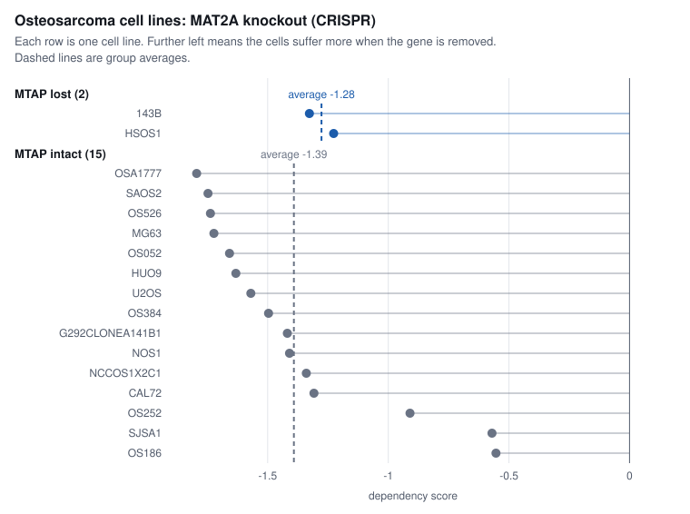

# Engine cycle 5: do osteosarcoma cells without MTAP depend more on PRMT5?

*Run November 24, 2026. The fifth cycle of the For John research engine. Pre-registration: `research_notes/Engine/cycle-05-mtap-prmt5/PREREGISTRATION.md`, committed at 20:11 UTC (commit `8ba7130`) before any DepMap file was downloaded. Script: `tools/engine_cycle05_06_depmap.py`. Results: `data/engine/cycle05/results.csv`.*

## Summary

The drug trials in cycle 4 rest on a finding from cancer cell lines: cells that have lost the gene MTAP are hurt more when PRMT5 is turned down. We checked whether that holds in osteosarcoma lines, using the public DepMap screens. Across all cancers the finding reproduced clearly. In osteosarcoma it could not be tested properly, because only 3 of the 27 osteosarcoma lines have lost MTAP, and only one or two of those were in each screen. By the rules set in advance the verdict is **inconclusive and underpowered**. What little there is points the expected way: the one MTAP-lost osteosarcoma line in the knockdown screen was the most PRMT5-dependent of five, and across 30 bone and soft-tissue sarcoma lines the difference was as large as in other cancers. The useful output is the list of which osteosarcoma lines a laboratory would need for a direct drug test.

**How to read the labels.** Every number here is **(our calculation)** from DepMap public data (24Q4 release and the DEMETER2 knockdown scores) unless marked otherwise. Scores are dependency scores: more negative means the cells suffer more when the gene is turned down or knocked out.

## What was tested

- **Hypothesis:** among osteosarcoma cell lines, those that have lost MTAP are more dependent on PRMT5 than those that keep it.
- **MTAP-lost,** by the rule fixed in advance: MTAP RNA below 1 on the log2(TPM+1) scale.
- **Two kinds of screen:** gene knockdown (RNAi), which turns a gene down and is where this relationship was first found; and gene knockout (CRISPR), which removes it. Knocking out PRMT5 harms almost every cell line, so the knockout screen separates the groups less well.

## Results

**Step 0, the positive control across all cancer types.** MTAP-lost lines minus MTAP-intact lines:

| Measure | MTAP-lost lines | MTAP-intact lines | Difference (95% CI) |
|---|---|---|---|
| PRMT5 knockdown (RNAi) | 113 | 553 | −0.46 (−0.53 to −0.40) |
| MAT2A knockdown (RNAi) | 114 | 552 | −0.20 (−0.26 to −0.13) |
| PRMT5 knockout (CRISPR) | 213 | 965 | −0.21 (−0.26 to −0.15) |
| MAT2A knockout (CRISPR) | 213 | 965 | −0.11 (−0.18 to −0.04) |

All four show the known relationship, so the data can test the question.

**Osteosarcoma lines:**

| Measure | MTAP-lost lines | MTAP-intact lines | Difference (95% CI) |
|---|---|---|---|
| PRMT5 knockdown (RNAi) | 1 | 4 | −0.45 (one line; no interval possible) |
| MAT2A knockdown (RNAi) | 1 | 4 | −0.09 (one line) |
| PRMT5 knockout (CRISPR) | 2 | 15 | −0.46 (−4.54 to +3.63) |
| **MAT2A knockout (CRISPR), the primary measure** | **2** | **15** | **+0.11 (−0.14 to +0.37)** |

- **Which measure was primary.** The plan named PRMT5 knockdown, falling back to MAT2A knockout if fewer than three lines per group had knockdown data. Only one MTAP-lost osteosarcoma line did, so the fallback applied.
- **Verdict: Inconclusive, and underpowered.** "Supported" needed a negative difference with an interval excluding zero. "Refuted" needed the whole interval above half the all-cancer effect (above −0.05); the lower end is −0.14. With two lines in one group, no result here could have been convincing.
- **The single knockdown data point.** The MTAP-lost line 143B scored −0.78 for PRMT5 knockdown, against −0.24 to −0.42 for the four MTAP-intact osteosarcoma lines. That is one cell line and proves nothing, but it is where the all-cancer pattern says it should be.

## Checks

- **Bone and soft-tissue sarcoma lines together** (5 MTAP-lost, 25 intact in the knockdown screen): PRMT5 knockdown −0.59 (−0.76 to −0.43). The relationship holds in sarcomas as a group, at least as strongly as across all cancers. In the knockout screen (14 lost, 77 intact): −0.13 (−0.42 to +0.16).
- **PRMT5's partner WDR77,** knockout: −0.37 across all cancers (−0.43 to −0.30); in osteosarcoma −0.52 (−2.13 to +1.09), two lines.
- **Defining MTAP loss by copy number** instead of RNA picks the same three lines and gives the same figures.

## A resource for laboratories

Osteosarcoma lines in DepMap by 9p21 status (full table with scores: `data/engine/cycle05/lines.csv`):

| Status | Lines |
|---|---|
| MTAP lost, CDKN2A deleted | 143B, HOS, HSOS1 |
| CDKN2A deleted, MTAP kept | MG63, CAL72, OS384 |
| Both intact (examples in common use) | U2OS, SAOS2, SJSA1, HUO9, G292, NOS1 |

- **143B was derived from HOS** (general knowledge), so those two are one patient's tumour. There are in effect two independent MTAP-lost osteosarcoma models in the collection.
- **CDKN2A loss does not guarantee MTAP loss.** Three of the six CDKN2A-deleted lines kept MTAP. Cycle 3 saw the same in patients (MTAP lost in 14 of 19 CDKN2A-deleted tumours). A patient's CDKN2A result is a pointer, not a substitute for testing MTAP.

## What this means

- **The gene-screen data cannot settle this for osteosarcoma.** There are too few MTAP-lost osteosarcoma lines in public collections, which is itself worth knowing.
- **The experiment that would settle it is small.** Treat the MTAP-lost lines (143B or HOS, and HSOS1) and a matched set of MTAP-intact lines with one of the MTAP-selective PRMT5 inhibitors now in trials, and compare. That is a few weeks' work for a laboratory that already grows these lines. It is added to the Research Queue as a partner question.
- **Prediction P20** is unresolved by its own rule.

## Limits

- Two or three cell lines. Every osteosarcoma figure above could move a long way with one more line.
- A gene screen is not the drug. The trial drugs act only in cells without MTAP by a mechanism that knockdown and knockout do not reproduce.
- Cell lines grown for decades differ from patients' tumours.
- The knockdown data are from an older release (DEMETER2) with fewer osteosarcoma lines than the knockout screen.

## Files and reproduction

- `python3 tools/engine_cycle05_06_depmap.py fetch` downloads six files (about 2.5 GB) from DepMap's official Figshare releases into `data/engine/depmap/raw/` (not stored in git); `python3 tools/engine_cycle05_06_depmap.py` runs cycles 5 and 6 in under a minute.
- Outputs: `data/engine/cycle05/results.csv`, `summary.json`, `lines.csv`; `docs/figures/engine05_mtap_primary.svg`.

**Data sources and credit.** Cell-line data are from the Cancer Dependency Map (DepMap, Broad Institute): DepMap 24Q4 Public release (Figshare, 2024), and the DEMETER2 combined knockdown scores (McFarland et al., Nature Communications 2018).

## Change log

- 2026-11-24: cycle run and reported. Verdict inconclusive and underpowered under the pre-registered rules.
- 2026-11-25: data sources credited.
