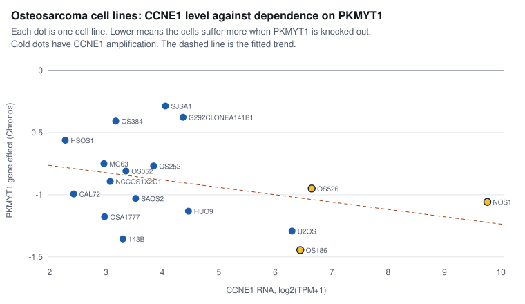

# Engine cycle 6: do osteosarcoma cells with more CCNE1 depend more on PKMYT1?

*Run November 24, 2026. The sixth cycle of the For John research engine. Pre-registration: `research_notes/Engine/cycle-06-ccne1-pkmyt1/PREREGISTRATION.md`, committed at 20:11 UTC (commit `2676040`) before any DepMap file was downloaded. Script: `tools/engine_cycle05_06_depmap.py`. Results: `data/engine/cycle06/results.csv`.*

## Summary

Tumours with extra copies of the gene CCNE1 have been shown to rely on an enzyme called PKMYT1, and a PKMYT1-blocking drug, lunresertib, is in trials for such cancers (general knowledge). About one in five osteosarcomas has extra CCNE1 (`reports/Copy-number changes and the kinase-pill biomarker.md`). We asked whether osteosarcoma cell lines with more CCNE1 depend more on PKMYT1, in the public DepMap gene-knockout screen. The trend ran in the expected direction, and was nominally steeper than across all cancers, but with 17 lines it could be chance: the slope was −0.06 with a range of uncertainty from −0.15 to +0.03. The pre-registered verdict is **inconclusive**. The cycle identifies four osteosarcoma lines with CCNE1 amplification that a laboratory could use to test the drug directly.

**How to read the labels.** Every number here is **(our calculation)** from DepMap public data (24Q4 release) unless marked otherwise. The PKMYT1 score is a gene-effect score: more negative means the cells suffer more when PKMYT1 is knocked out.

## What was tested

- **Hypothesis:** across osteosarcoma cell lines, more CCNE1 goes with stronger dependence on PKMYT1.
- **Measure:** the slope of a straight-line fit of the PKMYT1 knockout score on CCNE1 RNA (log2 scale). A negative slope means more CCNE1, more dependence. A continuous measure was chosen in advance because few lines were expected to be amplified.

## Results

**Step 0, the positive control across all cancer types** (1,103 lines): slope −0.031 per doubling of CCNE1 RNA (−0.054 to −0.008, p = 0.009). The known relationship is there, though weak in this screen. Lines with CCNE1 amplification (32) scored 0.18 lower than the rest (−0.39 to +0.03). The control passes on the first measure, so the test goes ahead.

**Osteosarcoma lines** (17 with both measurements):

| Analysis | Lines | Result (95% CI) |
|---|---|---|
| **Slope on CCNE1 RNA, the primary measure** | **17** | **−0.059 (−0.151 to +0.033), p = 0.19** |
| Rank correlation | 17 | −0.29, p = 0.25 |
| Slope on CCNE1 copy number | 17 | −0.009 (−0.042 to +0.025) |
| Amplified against not amplified | 3 v 14 | −0.31 (−0.81 to +0.20) |

- **Verdict: Inconclusive.** "Supported" needed a negative slope with an interval excluding zero. "Refuted" needed the whole interval above half the all-cancer slope (above −0.015); the lower end is −0.151. Seventeen lines met the minimum of ten set in advance, so the result is not flagged as underpowered, but the interval is wide.
- **Direction and size.** The osteosarcoma slope is negative and about twice the all-cancer slope. The three amplified lines with screen data averaged −1.15 against −0.85 for the rest.

## Checks

- **Bone and soft-tissue sarcoma lines together** (80 lines): slope −0.048 (−0.102 to +0.006), rank correlation −0.22 (p = 0.05). The same direction, and close to conventional significance.
- **CDK2,** the partner cyclin E1 works through: across all cancers more CCNE1 goes with clearly stronger CDK2 dependence (slope −0.079, −0.096 to −0.061); in osteosarcoma −0.016 (−0.122 to +0.090).
- **WEE1,** a related enzyme: no relationship with CCNE1, in all cancers or in osteosarcoma.

## A resource for laboratories

Osteosarcoma lines with CCNE1 amplification in DepMap (relative copy number of 2 or more; full table: `data/engine/cycle06/lines.csv`):

| Line | CCNE1 relative copy number | CCNE1 RNA | PKMYT1 score |
|---|---|---|---|
| OS526 | 23.8 | 6.7 | −0.95 |
| OS457 | 9.8 | 7.0 | not screened |
| OS186 | 6.4 | 6.4 | −1.45 |
| NOS1 | 3.8 | 9.8 | −1.06 |

Four of the 27 osteosarcoma lines (15%) are amplified, close to the 18.5% this project found in patients' tumours. U2OS has high CCNE1 RNA without amplification. Lines with low CCNE1 and weak PKMYT1 dependence, for comparison: SJSA1, G292, OS384.

## What this means

- **The public screen leans the right way and cannot confirm it.** Seventeen lines are too few for a relationship this modest.
- **A direct drug test is the next step,** and it is cheap: lunresertib or another PKMYT1 inhibitor in the four amplified lines against low-CCNE1 lines. It is added to the Research Queue as a partner question.
- **Worth doing from public data next:** how often CCNE1 is amplified in relapsed osteosarcoma, in the same hospital cohorts as cycle 3, and whether the open lunresertib trials would take an osteosarcoma patient, as in cycle 4.
- **Prediction P21** is unresolved by its own rule.

## Limits

- PKMYT1 knockout harms most cell lines to some degree in this screen, which leaves little room to see differences.
- Seventeen lines, one screen. A single line can move the slope.
- A gene knockout is not the drug, and cell lines are not patients' tumours.
- CCNE1 RNA and copy number disagree for some lines (U2OS high RNA, normal copy number), and the trials select patients by copy number, the measure that showed the weaker trend here.

## Files and reproduction

- As for cycle 5: `python3 tools/engine_cycle05_06_depmap.py fetch`, then `python3 tools/engine_cycle05_06_depmap.py`.
- Outputs: `data/engine/cycle06/results.csv`, `summary.json`, `lines.csv`; `docs/figures/engine06_ccne1_pkmyt1.svg`.

## Change log

- 2026-11-24: cycle run and reported. Verdict inconclusive under the pre-registered rules.
