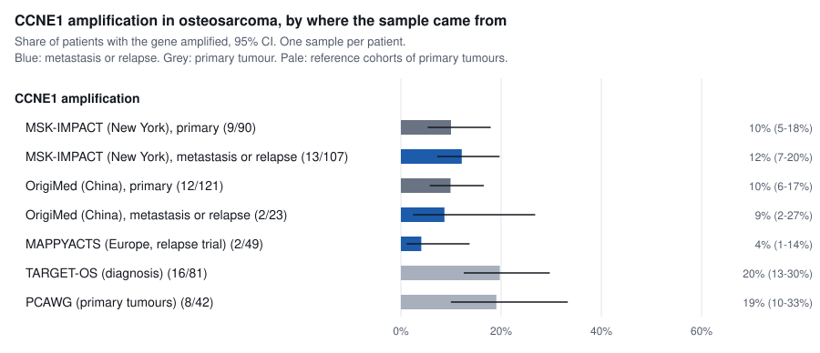

# Engine cycle 7: how common is CCNE1 amplification in relapsed osteosarcoma, and which trials could those patients join?

*Run November 24, 2026. The seventh cycle of the For John research engine. Pre-registration: `research_notes/Engine/cycle-07-ccne1-relapse-trials/PREREGISTRATION.md`, committed at 21:09 UTC (commit `5d5b032`) before any amplification call was read or any trial search run. Script: `tools/engine_cycle07_ccne1.py`. Results: `data/engine/cycle07/results.csv` and `data/engine/cycle07/trials_classified.csv`.*

**Not medical advice.** The trial section reports what ClinicalTrials.gov records said on November 24, 2026. Whether a trial suits a particular patient is a question for that patient's oncologist and the trial team.

## Summary

Some osteosarcomas carry extra copies of the gene CCNE1, and drugs are being tested in patients chosen for exactly that. We asked two things. First, is the change more common once the disease has spread or returned? Not clearly: the odds ratio was 1.14, with a range of uncertainty from 0.52 to 2.48, so the pre-registered verdict is **inconclusive**. On tumour gene tests (two hospital panels and one research trial) about one in ten relapsed or metastatic osteosarcomas has it (17 of 179). In the few patients tested twice it usually matched, but only three of them ever had it, so that tells us little. Second, would the trials take these patients? Eight trials, recruiting or about to, would take an osteosarcoma patient with CCNE1 amplification on paper, five with a United States site. The best news is about age: a trial of lunresertib, which blocks the enzyme PKMYT1, accepts patients from age 12 with any advanced solid tumour that has CCNE1 amplification, at sites in the United States, Canada, Denmark, Spain and the United Kingdom. One unplanned observation, that MCL1 amplification looked more common at relapse, is reported with its caveats and is not a finding.

**How to read the labels.** Numbers are **(our calculation)** from open data and registry records unless marked otherwise.

## Part A: how common is it?

The method is cycle 3's, on the same two hospital cohorts from cBioPortal, each patient counted once. Amplification is each study's own call.

| Cohort | Metastasis or relapse | Primary | Odds ratio (95% CI) |
|---|---|---|---|
| MSK-IMPACT, New York | 13 of 107 (12.1%) | 9 of 90 (10.0%) | 1.24 (0.51–3.06) |
| OrigiMed, China | 2 of 23 (8.7%) | 12 of 121 (9.9%) | 0.87 (0.18–4.15) |
| **Pooled** | | | **1.14 (0.52–2.48), p = 0.75** |
| Pooled, adjusted for tumour purity | | | 1.14 (0.52–2.50) |

- **Verdict: Inconclusive.** "Supported" needed an odds ratio of at least 1.5 with a lower bound above 1. "Refuted" needed the upper bound below 1.5; it is 2.48. The two cohorts agree with each other (I² = 0%), and both show about the same rate in each group.
- **Frequency at relapse:** 17 of 179 metastatic or relapsed patients (9.5%, 95% CI 6.0–14.7%) across the two cohorts and the European relapse trial MAPPYACTS (2 of 49).
- **Within a patient.** Of 30 patients with both a primary and a later sample tested, 27 had no amplification in either, one had it in both, one gained it and one lost it. With only three patients ever amplified, this cannot show whether the change is stable.
- **Why this is lower than the diagnosis figure.** Research cohorts that sequence whole genomes call CCNE1 amplified in about one in five primary tumours: 16 of 81 in TARGET-OS and 8 of 42 in PCAWG by cBioPortal's calls, and 15 of 81 by this project's own. The difference may reflect how each test calls an amplification (not checked here). Trials enrol on clinical test results, so the panel figure is the closer guide to eligibility.

**An unplanned observation: MCL1.** The plan included a check on every gene amplified in more than 3% of patients, to see whether CCNE1 stood out. It did not, but one of the 38 genes did.

- MCL1 was amplified in 15 of 130 relapse-group patients (11.5%) and 6 of 211 primary-group patients (2.8%), an odds ratio of 5.24 (1.93–14.18). Both cohorts pointed the same way (10 of 107 against 3 of 90; 5 of 23 against 3 of 121).
- Reasons for caution. It is one of 38 comparisons that were not the question, so a result this strong will sometimes arise by chance. Among the 30 patients tested twice, none gained MCL1 amplification and two lost it. MAPPYACTS, where every patient had relapsed, recorded none in 49. And the whole-genome research cohorts call it in about one in five primary tumours.
- A 2025 paper reports that MCL1 copy gain is frequent in osteosarcoma and a possible target (paper, title only; PMID 39663392). Cycle 8's scan independently found that cell lines with MCL1 gain depend on MCL1.
- This is a lead for a future pre-registered test in a cohort not used here. It is not a result.

## Part B: which trials?

The search used 24 terms fixed in advance (PKMYT1, MYT1, CCNE1, cyclin E1 and 20 drug names) and returned 81 trials. Twenty-one were open in some form and mentioned PKMYT1 or CCNE1; each was read. Seventeen met the rule: they test a PKMYT1 inhibitor or require CCNE1 amplification or cyclin E1 overexpression for at least one group.

| | Trials |
|---|---|
| A. Recruiting or about to, and open on paper to an osteosarcoma patient with CCNE1 amplification | **8** (7 recruiting, 1 not yet) |
| … of which name sarcoma of bone | 0 |
| … of which require CCNE1 amplification or overexpression | 7 |
| … of which test a PKMYT1 inhibitor | 2 |
| B. Of A, accept patients under 18 | **1** (from age 12) |
| C. Of A, have a site in the United States | **5** |
| Unclear from the record | 2 |
| Limited to ovarian, breast or uterine cancer | 7 |

**The eight:**

| Registry number | Drug and type | Sponsor | Youngest age | Where | Note |
|---|---|---|---|---|---|
| NCT04855656 | Lunresertib, a PKMYT1 inhibitor, alone or with two other drugs | Debiopharm | **12** (and at least 40 kg) | United States, Canada, Denmark, Spain, United Kingdom | Any advanced solid tumour with CCNE1 amplification, or an FBXW7 or PPP2R1A mutation |
| NCT05735080 | INX-315, a CDK2 inhibitor | Incyclix Bio | 18 | United States, Australia | One part takes any advanced solid tumour with known CCNE1 amplification |
| NCT06586957 | NKT3964, a CDK2 degrader | NiKang Therapeutics | 19 | United States, South Korea | Dose-finding part includes "other solid tumours with CCNE1 amplification" |
| NCT06726148 | ECI830 (type not stated in the record) | Novartis | 18 | United States and 15 other countries | Any advanced cancer with CCNE1 amplification |
| NCT07288359 | GVV858 (type not stated in the record) | Novartis | 18 | United States and 10 other countries | Any advanced cancer with CCNE1 amplification |
| NCT07524140 | ZE94-0605, a CDK2 inhibitor | Eilean Therapeutics | 18 | Australia, Uzbekistan | CCNE1 amplification required in the second part |
| NCT06953323 | WJB001, a WEE1 inhibitor, with other drugs | Wigen Biomedicine | 18 | China | CCNE1 overexpression by tissue stain |
| NCT07933666 | FXS0260, a PKMYT1 inhibitor | Shanghai Fosun Pharmaceutical | 18 | China | Not yet recruiting; any advanced solid tumour |

- **Two more are unclear.** A CDK2-inhibitor trial (AVZO-021, NCT05867251) takes other CCNE1-amplified tumours only by case-by-case approval, and a trial of a combined WEE1 and PKMYT1 inhibitor (ACR-2316, NCT06667141) takes "selected solid tumours" that the record does not list.
- **One closed trial shut bone cancers out by name.** A CDK2-inhibitor study (NCT05238922, no longer enrolling) had a group for "other tumour indications excluding bone cancers". The record gives no reason.

## What this means

- **A teenager with relapsed osteosarcoma and CCNE1 amplification has a trial to ask about,** which for MTAP loss (cycle 4) was true only in China. The lunresertib trial takes patients from 12.
- **About one in ten relapsed or metastatic osteosarcomas carried CCNE1 amplification on tumour gene tests, the change these trials select for.** Whether a test done at diagnosis is a reliable guide for CCNE1 is not known from these data; a trial may ask for a new one.
- **Not evidence that the drugs work in osteosarcoma.** Cycle 6 found that osteosarcoma cell lines with more CCNE1 lean towards depending on PKMYT1 without confirming it, and no osteosarcoma result has been reported from these trials that this project has found.
- **Predictions.** P22 (more common at relapse) is unresolved by its own rule. P23 (at least one such trial accepts under-18s), which this project gave a 10% chance, is right.

## Limits

- Hospital sequencing favours patients with advanced disease, so the "primary" group is not a sample of all patients at diagnosis.
- Amplification calls differ between tests and laboratories, as the gap between one in ten and one in five shows.
- The OrigiMed relapse group has 23 patients.
- A registry snapshot on one day. "Any solid tumour" can hide limits, and sites listed may not be enrolling. One reader classified the records; the table is public.
- The MCL1 observation was not planned and is contradicted by some of the data described above.

## Files and reproduction

- `python3 tools/engine_cycle07_ccne1.py fetch` (needs cycle 3's fetch first), then `python3 tools/engine_cycle07_ccne1.py`.
- Outputs: `data/engine/cycle07/results.csv`, `summary.json`, `trials.csv` (all 81), `trials_classified.csv` (the 21 read), `classification.csv` (the hand classification); `docs/figures/engine07_ccne1.svg`.

**Data sources and credit.** Patient data were read from cBioPortal (Cerami et al., Cancer Discovery 2012; Gao et al., Science Signaling 2013) and come from the original studies: MSK-IMPACT 50K Clinical Sequencing Cohort (Memorial Sloan Kettering), China Pan-cancer (OrigiMed, Nature 2022), MAPPYACTS (Gustave Roussy, Cancer Discovery 2022), TARGET-OS (NCI TARGET, via the GDC) and the Pan-Cancer Analysis of Whole Genomes (Nature 2020). Only counts and summary statistics are published here; the per-patient table stays with the local download.

## Change log

- 2026-11-28: after a second independent check, "would qualify" replaced with what was measured.
- 2026-11-27: corrected after an independent check: one trial (NKT5097, NCT07029399) was counted although it neither requires CCNE1 amplification nor tests a PKMYT1 inhibitor, so it does not meet the pre-registered rule. Trials: 8, not 9; with a US site: 5, not 6; the under-18 count is unchanged. Search-term breakdown corrected.
- 2026-11-24: cycle run and reported. Part A inconclusive under the pre-registered rules; Part B counted.
- 2026-11-25: per-patient table no longer published (counts only); data sources credited.
- 2026-11-25: corrected after an independent check. The claim that CCNE1 amplification is stable between primary and later samples was withdrawn: only three paired patients were ever amplified, and two of the three disagreed.
