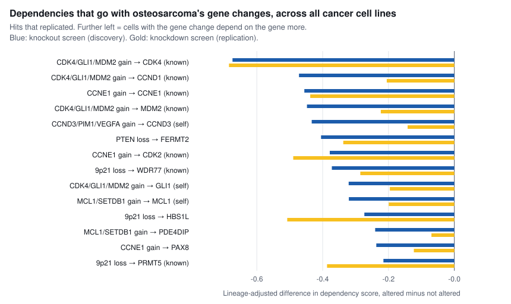

# Engine cycle 8: a scan for drug weaknesses that go with osteosarcoma's gene changes

*Run November 24, 2026. The eighth cycle of the For John research engine. Pre-registration: `research_notes/Engine/cycle-08-dependency-scan/PREREGISTRATION.md`, committed at 21:09 UTC (commit `940146d`) before the scan was run. Script: `tools/engine_cycle08_scan.py`. Results: `data/engine/cycle08/hits.csv`.*

## Summary

Cycles 5 and 6 each tested one hand-picked pair: a gene an osteosarcoma has lost or gained, and a second gene the cell then cannot do without. This cycle looked for such pairs systematically. It took the gene losses and gains seen in osteosarcoma patients and, for each, compared every one of 17,205 genes across 1,178 cancer cell lines: about 1.2 million comparisons. It is a discovery scan, so the method and thresholds were fixed in advance and every hit had to show up again in a second, different kind of screen. Fifty-four pairs passed the first screen and fourteen of those replicated. Seven of the fourteen are pairs already known to science, including the two this project tested by hand, which shows the scan works. The other seven held no hidden drug target: four are a tumour depending on its own amplified gene or a likely artefact, two turned out on checking to be recently published, and one (cells without PTEN depending on FERMT2) has no paper we could find and rests on few cell lines. The most useful output is a pointer to work that already has a drug behind it: tumours whose 9p21 deletion reaches a gene called FOCAD depend on HBS1L, a company has a drug for that in development, and about 4% of osteosarcomas carry the deletion.

**How to read the labels.** Numbers are **(our calculation)** from DepMap public data (24Q4 knockout scores, DEMETER2 knockdown scores) and the patient cohorts of cycles 3 and 7, unless marked otherwise. A scan hit is a candidate, not a finding.

## What was done

1. **Gene changes seen in patients.** Thirty-three "anchor" genes deep-deleted in at least 3%, or amplified in at least 5%, of 197 osteosarcoma patients tested at Memorial Sloan Kettering. To these were added 61 "passenger" genes that are deleted alongside an anchor in TARGET-OS, which is how bystander genes like MTAP get in. Ninety-four gene changes in all (`data/engine/cycle08/alterations.csv`).
2. **The scan.** Seventy-two of the 94 are carried by at least ten cell lines and were scanned. For each, every gene in the knockout screen was compared between lines with and without the change, adjusting for tissue type. A hit needed a difference of at least 0.2 in the dependency score with a false-discovery rate below 5% across all 1,238,742 comparisons.
3. **Replication.** Each hit was re-tested in the knockdown screens, a separate technology. It replicated if the same difference appeared there with a 95% interval excluding zero.
4. **Grouping.** Gene changes that travel together (for example CDK4 and MDM2, amplified side by side) were grouped into 12 blocks so that each dependency is reported once per block.

## Results

| | Pairs |
|---|---|
| Compared | 1,238,742 |
| Hits in the knockout screen | 54 |
| … replicated in the knockdown screen | **14** |
| … did not replicate | 31 |
| … could not be re-tested (too few lines) | 9 |

**The fourteen replicated hits.** Effect is the lineage-adjusted difference in dependency score, altered lines minus the rest; more negative means the altered lines need the gene more.

| Gene change (share of osteosarcoma patients) | Depends on | Knockout effect | Knockdown effect (95% CI) | What it is |
|---|---|---|---|---|
| 9p21 loss (20%) | PRMT5 | −0.22 | −0.39 (−0.43 to −0.34) | **Known.** The pair behind the trials in cycle 4 |
| 9p21 loss | WDR77 | −0.37 | −0.29 (−0.33 to −0.24) | **Known.** PRMT5's partner |
| 9p21 loss reaching FOCAD (about 4%) | HBS1L | −0.27 | −0.51 (−0.60 to −0.42) | Not on our list; **published in 2025**, drug in development (see below) |
| CCNE1 gain (11%) | CDK2 | −0.38 | −0.49 (−0.62 to −0.36) | **Known.** The basis of the CDK2 trials in cycle 7 |
| CCNE1 gain | CCNE1 itself | −0.46 | −0.44 (−0.55 to −0.33) | **Known.** Self-dependence |
| CCNE1 gain | PAX8 | −0.24 | −0.12 (−0.21 to −0.04) | Likely an artefact: CCNE1-amplified lines are mostly ovarian, and ovarian cells need PAX8 |
| CDK4 gain (11%) | CDK4 itself | −0.67 | −0.68 (−0.86 to −0.51) | **Known.** Self-dependence; approved CDK4/6 inhibitors exist |
| CDK4 gain | CCND1 | −0.47 | −0.21 (−0.41 to 0.00) | **Known.** CDK4's partner |
| MDM2 gain (9%) | MDM2 itself | −0.45 | −0.22 (−0.36 to −0.08) | **Known.** Self-dependence; MDM2 inhibitors are in trials |
| GLI1 gain (6%) | GLI1 itself | −0.32 | −0.20 (−0.32 to −0.07) | Self-dependence; GLI1 sits beside CDK4 and is amplified with it |
| CCND3 gain (14%) | CCND3 itself | −0.43 | −0.14 (−0.28 to −0.01) | Self-dependence |
| MCL1 gain (7%) | MCL1 itself | −0.32 | −0.20 (−0.34 to −0.06) | Self-dependence; **published for osteosarcoma in 2025** (see below) |
| MCL1 gain | PDE4DIP | −0.24 | −0.07 (−0.13 to −0.01) | Probably an artefact: PDE4DIP sits near MCL1 and the knockdown effect is tiny |
| PTEN loss (5%) | FERMT2 | −0.41 | −0.34 (−0.52 to −0.15) | **No paper found.** Rests on 18 lines in one screen and 8 in the other |

**The scan recovered most of what it should.** Of the six pre-listed groups that could be scanned, four appear: 9p21 with PRMT5 and WDR77, CCNE1 with CDK2, CDK4 with CCND1, and MDM2 with itself. Two did not: MYC gain with MYC passed the knockout screen but not the knockdown screen, and PTEN loss did not show its expected partners. RB1 could not be scanned (see below). Cycles 5 and 6 could not confirm the 9p21 and CCNE1 pairs in osteosarcoma lines alone; across all cancers they are plain.

## The three worth following

**1. FOCAD loss and HBS1L (or PELO).** FOCAD lies at the far edge of the 9p21 region. Tumours whose deletion reaches it lose a piece of the cell's machinery for clearing stalled protein synthesis, and then depend on a back-up system made of HBS1L and PELO.

- The scan found this through a neighbouring passenger gene (HACD4), without being told about FOCAD. PELO was the single strongest hit in the knockout screen (−0.89) but had too few altered lines in the knockdown screen to replicate there; HBS1L replicated.
- It was not on this project's list of known pairs, but it is published: two papers in 2025 reported that cancers with this deletion depend on PELO (paper, title only; PMIDs 39910293, 39910291), and a 2026 paper describes an oral drug that destroys HBS1L, built for FOCAD-deleted cancers (paper, title only; PMID 42001523).
- In osteosarcoma patients, FOCAD was deep-deleted in 3 of 81 TARGET-OS tumours (3.7%) and 1 of 42 in PCAWG, in each case alongside CDKN2A. That is roughly one in three of the tumours with a 9p21 deletion.
- One osteosarcoma cell line in DepMap, HSOS1, has lost FOCAD and could be used to test the idea.

**2. MCL1 gain and MCL1.** Cell lines with extra MCL1 depend on it. A 2025 paper reports the same for osteosarcoma specifically (paper, title only; PMID 39663392), and cycle 7 saw, as an unplanned observation, more MCL1 amplification in relapsed patients. In the three MCL1-gained osteosarcoma lines with screen data the dependency did not show (difference +0.16), which with three lines says little either way. Drugs against MCL1 exist but have been held back by heart side effects (general knowledge).

**3. PTEN loss and FERMT2.** The only replicated pair that is neither self-dependence, nor an obvious artefact, nor in a paper we could find. FERMT2 (kindlin-2) helps cells grip their surroundings through integrins. About 5% of osteosarcomas have lost PTEN. It rests on few cell lines, has no drug, and needs testing in an independent dataset before anyone treats it as real.

**Exploratory look-ups, made after the scan.** CCND3 is amplified in 14% of patients and its usual partners are the targets of approved CDK4/6 inhibitors, so two named pairs were checked: CCND3 gain against CDK6 (−0.14, not significant) and against CDK4 (+0.12). The scan gives no support for CDK4/6 inhibitors in CCND3-amplified tumours.

## What could not be scanned

- **RB1 and TP53**, the two tumour-suppressor genes most often lost in osteosarcoma, and **ATRX**. Each is deep-deleted in fewer than ten cell lines by the copy-number rule used here, because cell lines mostly lose these genes through mutations or small deletions that the rule misses. A second scan that defines loss by missing RNA or by mutation is the obvious next step, and is added to the Research Queue.
- Twenty-two of the 94 gene changes in all had too few cell lines.

## What this means

- **The method works and is reusable.** It rediscovered seven established pairs and two published in the last two years without being told about them.
- **No unknown, druggable weakness turned up** among osteosarcoma's copy-number changes. That is a real, if unexciting, result: the copy-number changes that are common in this disease have been well searched by others.
- **One concrete pointer for patients with 9p21 deletion:** a tumour report showing the deletion reaching FOCAD is worth knowing about as HBS1L-directed drugs enter trials.
- **Predictions.** P24 (the scan recovers a known 9p21 pair) is right. P25 (a replicated, unlisted hit with a late-stage drug) is met only by MCL1 depending on itself, with a non-selective drug in the project's table; that is the letter of the prediction and not its point, so it is recorded as ambiguous and not scored.

## Limits

- Cell lines are not tumours, a gene knockout is not a drug, and these are relationships across all cancers. Osteosarcoma lines are too few to confirm any of them (the table in `hits.csv` gives the osteosarcoma and sarcoma figures for each).
- Adjusting for tissue type reduces confounding but does not remove it, as the PAX8 hit shows.
- Copy number alone defined each gene change.
- The rule for passenger genes let in a few deletions that are common in TARGET-OS on their own (at 3q13.31) and listed them under an unrelated anchor. None of their hits replicated.
- The literature check was a title search, not a review. "No paper found" is not proof of novelty.

## Files and reproduction

- Needs the downloads of cycles 3, 5 and 7. Then `python3 tools/engine_cycle08_scan.py` (about two minutes).
- Outputs: `data/engine/cycle08/alterations.csv` (the 94 gene changes), `hits.csv` (all 54 hits with replication, osteosarcoma and sarcoma figures, drugs), `exploratory_lookups.csv`, `summary.json`; `docs/figures/engine08_scan.svg`.

**Data sources and credit.** Cell-line data are from the Cancer Dependency Map (DepMap, Broad Institute): DepMap 24Q4 Public release (Figshare, 2024), and the DEMETER2 combined knockdown scores (McFarland et al., Nature Communications 2018).
Patient data were read from cBioPortal (Cerami et al., Cancer Discovery 2012; Gao et al., Science Signaling 2013) and come from the original studies: MSK-IMPACT 50K Clinical Sequencing Cohort (Memorial Sloan Kettering), China Pan-cancer (OrigiMed, Nature 2022), MAPPYACTS (Gustave Roussy, Cancer Discovery 2022), TARGET-OS (NCI TARGET, via the GDC) and the Pan-Cancer Analysis of Whole Genomes (Nature 2020). Only counts and summary statistics are published here; the per-patient table stays with the local download.

## Change log

- 2026-11-24: scan run and reported. After the first run, six named pairs were looked up (`exploratory_lookups.csv`) and FOCAD's frequency in patients was checked; both are marked exploratory.
- 2026-11-25: data sources credited.
