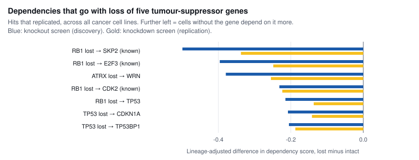

# Engine cycle 9: weaknesses that go with the tumour-suppressor genes osteosarcoma loses

*Run November 24, 2026. The ninth cycle of the For John research engine. Pre-registration: `research_notes/Engine/cycle-09-suppressor-scan/PREREGISTRATION.md`, committed at 22:54 UTC (commit `18b31b0`) before the mutation files were downloaded or any comparison run. Script: `tools/engine_cycle09_suppressor_scan.py`. Results: `data/engine/cycle09/hits.csv`.*

## Summary

Cycle 8 scanned osteosarcoma's gene gains and losses but could not include RB1, TP53 and ATRX, the brakes on cell growth that this cancer most often breaks, because cell lines usually lose them through mutations rather than whole-gene deletions. This scan used mutation data as well, for five such genes. Both built-in checks passed, so the method for calling a gene lost works. It found ten pairs and seven replicated in a second kind of screen. The three strongest are known biology: cells without RB1 depend on SKP2, E2F3 and CDK2. The others are explained by how the screen scores TP53, or, for ATRX with WRN, by a confounder: half the ATRX-lost cell lines are a type of cancer that already depends on WRN. With those lines removed, an exploratory check showed what ATRX-lost cells are known to need: FANCM, SMARCAL1 and ATR, the machinery of the back-up way of maintaining chromosome ends that ATRX-lost tumours use. Nothing new and druggable turned up. The most useful lesson is about osteosarcoma itself: it breaks TP53 and ATRX mostly by large rearrangements that public cell-line data do not capture, so these genes are under-counted in the very cancer that loses them most.

**How to read the labels.** Numbers are **(our calculation)** from DepMap public data (24Q4 release, DEMETER2 knockdown scores) and cBioPortal, unless marked otherwise. A scan hit is a candidate, not a finding.

## How often osteosarcoma loses these genes

From 197 osteosarcoma patients tested at Memorial Sloan Kettering, one sample each, counting a deep deletion or a truncating mutation (for TP53, also a missense mutation):

| Gene | Patients | Share |
|---|---|---|
| TP53 | 70 (20 deletion, 50 mutation) | 36% |
| RB1 | 36 (19 deletion, 17 mutation) | 18% |
| ATRX | 19 (7 deletion, 12 mutation) | 10% |
| PTEN | 11 | 6% |
| NF1 | 6 | 3% |

Gene-panel tests miss large rearrangements, which is how osteosarcoma often breaks TP53 and ATRX (general knowledge), so these are lower limits.

## What was done

- **Calling a gene lost in a cell line.** For RB1, ATRX, PTEN and NF1: a damaging mutation, a deep deletion or near-absent RNA. For TP53: a damaging or hotspot mutation or a deep deletion. Lost lines: RB1 86, TP53 773, ATRX 25, PTEN 146, NF1 74, out of about 1,100.
- **The scan,** as in cycle 8: every gene in the knockout screen compared between lost and intact lines, adjusting for tissue type; 86,020 comparisons; a hit needed a difference of at least 0.2 at a false-discovery rate below 5%, then had to replicate in the knockdown screen.
- **Two built-in checks,** fixed in advance. Lines with broken TP53 should need MDM2 less (it matters only when TP53 works): difference +0.65 (+0.61 to +0.70), **passed**. Lines without RB1 should need CDK4, CDK6 and CCND1 less (they act through RB1): +0.45, +0.36 and +0.81, all with intervals excluding zero, **passed**.

## Results

| Gene lost | Depends on | Knockout effect | Knockdown effect (95% CI) | Replicated | What it is |
|---|---|---|---|---|---|
| RB1 | SKP2 | −0.50 | −0.34 (−0.42 to −0.26) | yes | **Known.** SKP2 breaks down a brake that RB1-lost cells rely on |
| RB1 | E2F3 | −0.40 | −0.25 (−0.30 to −0.19) | yes | **Known.** The growth signal RB1 normally holds in check |
| RB1 | CDK2 | −0.23 | −0.22 (−0.32 to −0.12) | yes | **Known.** The same CDK2 that cycle 7's trials target |
| ATRX | WRN | −0.38 | −0.26 (−0.44 to −0.07) | yes | Confounded (see below) |
| RB1 | TP53 | −0.22 | −0.14 (−0.26 to −0.01) | yes | Artefact of scoring (see below) |
| TP53 | CDKN1A | −0.21 | −0.14 (−0.18 to −0.11) | yes | Artefact of scoring |
| TP53 | TP53BP1 | −0.21 | −0.19 (−0.22 to −0.16) | yes | Artefact of scoring |
| ATRX | FANCM | −0.24 | −0.02 (−0.14 to +0.09) | no | **Known** |
| ATRX | SMARCAL1 | −0.22 | +0.01 (−0.07 to +0.10) | no | **Known** |
| ATRX | PELO | −0.32 | +0.07 (−0.03 to +0.17) | no | |

**The three TP53 artefacts.** Knocking out TP53, or the genes that help it work (CDKN1A, TP53BP1), makes cells with working TP53 grow faster, which the screen records as a positive score. In cells where TP53 is already broken that advantage disappears, so the difference comes out negative. That is the mirror image of the MDM2 check, not a weakness. RB1-lost lines show the same effect because they often have broken TP53 as well.

**ATRX and WRN: a confounder.** WRN is the best-known weakness of cancers with faulty DNA mismatch repair (microsatellite-unstable cancers). Those cancers pick up ATRX mutations along with thousands of others, and 48% of the ATRX-lost lines were microsatellite-unstable, against 6% of the rest. Osteosarcomas are almost never microsatellite-unstable (general knowledge), so this pair says nothing about them.

**Exploratory, after the scan: ATRX without the unstable lines.** Re-running five ATRX pairs on the 13 ATRX-lost lines that are not microsatellite-unstable:

| Depends on | Difference (95% CI) |
|---|---|
| FANCM | −0.38 (−0.52 to −0.24) |
| SMARCAL1 | −0.25 (−0.34 to −0.17) |
| ATR | −0.23 (−0.37 to −0.08) |
| WRN | −0.17 (−0.26 to −0.08) |
| PELO | −0.13 (−0.36 to +0.11) |

FANCM, SMARCAL1 and ATR are what cells without ATRX are known to need when they keep their chromosome ends long by the back-up route called ALT (general knowledge). Most osteosarcomas use ALT. ATR inhibitors exist and are in late-stage trials in other cancers (general knowledge); whether ALT osteosarcoma responds to them has been argued over in published laboratory work and is not settled. This is a check on known biology, not a new lead.

## The limit that matters for osteosarcoma

The rule for calling a gene lost works across cancers, as the checks show, but it misses osteosarcoma's usual route.

- **TP53.** Osteosarcoma often breaks TP53 by a rearrangement inside the gene. Three osteosarcoma lines with almost no TP53 RNA (OS384, CAL72, OS252) were called intact for TP53 by the mutation-based rule, and only 5 of 17 osteosarcoma lines were called altered.
- **ATRX.** U2OS, a widely used osteosarcoma line known to have lost ATRX through a large deletion (general knowledge), still shows ATRX RNA, presumably from the remaining fragment, and was called intact. Only 2 of 17 osteosarcoma lines were called ATRX-lost.
- **What fixes it:** structural-variant calls from whole-genome sequencing of the cell lines, or ATRX protein staining. Neither is in the public DepMap release used here.

For laboratories: in the knockout screen, the osteosarcoma lines that depend most on FANCM are SAOS2 (−1.75), CAL72 (−1.42), OS384 (−1.14), U2OS (−1.08), HUO9 (−1.08), NOS1 (−1.07) and OS052 (−1.05). SAOS2 and U2OS are well-known ALT lines.

## What this means

- **The method is sound.** It passed both checks and rediscovered the RB1 pairs.
- **No new, druggable weakness** goes with loss of these five genes in the public screens.
- **Osteosarcoma needs its own data here.** Its main ways of breaking TP53 and ATRX are invisible to mutation and RNA calls, so a cancer-wide scan cannot speak for it. The question is added to the Research Queue: rerun this with structural-variant calls once a source is found.
- **Predictions.** P26 (both checks pass) is right. P27 (a known pair for RB1, PTEN, NF1 or ATRX replicates) is right. P28 is met only on its wording: the one unlisted replicated pair with a drug in the project's table is RB1 with TP53, an artefact of scoring, with an MDM2 inhibitor listed against TP53. As with P25, it is recorded as ambiguous and not scored.

## Limits

- Cell lines are not tumours, a gene knockout is not a drug, and these are relationships across all cancers.
- A damaging mutation in one copy does not always mean the gene is lost; near-absent RNA can reflect cell type.
- Adjusting for tissue type does not remove all confounding, as WRN showed. Microsatellite status was not part of the plan and was checked afterwards.
- PTEN and NF1 gave no hits; NF1 has no osteosarcoma line called lost, and PTEN one.

## Files and reproduction

- `python3 tools/engine_cycle09_suppressor_scan.py fetch` (three DepMap files and patient mutations from cBioPortal; needs the downloads of cycles 3, 5 and 8), then `python3 tools/engine_cycle09_suppressor_scan.py` (about a minute).
- Outputs: `data/engine/cycle09/loss_calls.csv` (every line's call and the route), `controls.csv`, `hits.csv`, `patients.csv`, `summary.json` (includes the exploratory ATRX check); `docs/figures/engine09_scan.svg`.

## Change log

- 2026-11-24: scan run and reported. The microsatellite check on the ATRX pairs was added after the scan and is marked exploratory.
